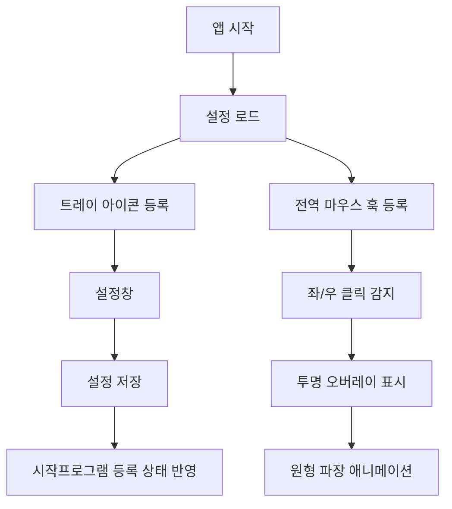

# Rust 클릭 효과 앱 구현 계획

## 구현 방향
- 현재 저장소에는 실제 애플리케이션 소스가 없으므로 새 Rust 프로젝트를 루트에 구성합니다.
- 경량화를 위해 Tauri 같은 웹뷰 기반 프레임워크는 사용하지 않고, `windows` crate 기반 Win32 네이티브 앱으로 구현합니다.
- 기준 요구사항은 [`.cursor/rules/project-standards.mdc`](.cursor/rules/project-standards.mdc)의 다음 항목입니다.

```5:20:.cursor/rules/project-standards.mdc
# 프로젝트 개요
- 마우스의 클릭을 시각적으로 표현하는 어플리케이션이다.
- 최대한 경량화 된 프로그램을 추구한다.

## 어플리케이션
- Rust기반 윈도우 어플리케이션
- 기동시 작업표시줄에 상주
- 포터블실행파일 (무설치)

## 어플리케이션의 기능
- 마우스를 클릭했을때 포인터를 중심으로 동그라미 효과가(마치 연못에 돌을 던졌을때 파장효과 처럼) 나타난다.

## 설정창에서 아래의 설정이 가능함
- 마우스 왼쪽 클릭 효과 색깔
- 마우스 오른쪽 클릭 효과 색깔
- 윈도우 실행시 기동할 것인지 선택
```

## 주요 파일
- [`Cargo.toml`](Cargo.toml): Rust 패키지와 `windows`, `serde`, 설정 저장용 의존성 정의
- [`src/main.rs`](src/main.rs): Win32 메시지 루프, 트레이 아이콘, 전역 마우스 훅, 오버레이 윈도우 진입점
- [`src/config.rs`](src/config.rs): 좌/우 클릭 색상, 시작프로그램 여부를 JSON 설정 파일로 저장/로드
- [`src/startup.rs`](src/startup.rs): 현재 실행 파일을 Windows 시작프로그램 레지스트리에 등록/해제
- [`src/tray.rs`](src/tray.rs): 작업표시줄 트레이 아이콘, 설정/종료 메뉴 처리
- [`src/effect.rs`](src/effect.rs): 클릭 위치 주변 원형 파장 애니메이션 렌더링

## 동작 구조


## 구현 세부
- 앱은 콘솔 창이 뜨지 않도록 Windows 서브시스템으로 빌드합니다.
- 전역 마우스 입력은 `SetWindowsHookExW(WH_MOUSE_LL)`로 감지합니다.
- 클릭 효과는 화면 전체를 덮는 투명/클릭 통과 오버레이 윈도우에서 GDI로 원형 테두리를 점점 확대하며 그립니다.
- 설정창은 별도 UI 프레임워크 없이 간단한 Win32 네이티브 창으로 구성합니다.
- 색상 선택은 Windows 공용 색상 선택 대화상자 또는 단순 RGB 입력 중, 구현 안정성이 높은 방식으로 적용합니다.
- 시작프로그램 옵션은 `HKCU\Software\Microsoft\Windows\CurrentVersion\Run`에 현재 실행 파일 경로를 등록/삭제합니다.

## 검증
- `cargo check`로 컴파일 검증을 수행합니다.
- 가능하면 `cargo build --release`까지 확인해 포터블 실행 파일 생성 여부를 검증합니다.
- 런타임 UI 동작은 Windows 환경에서 수동 확인이 필요합니다: 트레이 상주, 좌/우 클릭 효과, 설정 저장, 시작프로그램 토글.