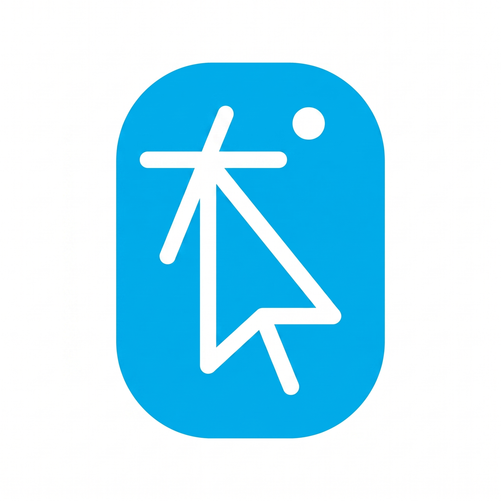

<p align="center">
  
</p>

# ccesdgr

GMTL Mouse Click — Win32 tray app for click visualization, GIF recording, snapshots, and screen annotation.

App icon: `assets/icon-entry-3.png` (blue rounded rect, white cursor). Build embeds a multi-size `.ico` for the `.exe` and tray — same asset on light and dark taskbars.

**Documentation:** [docs/README.md](docs/README.md)  
**Architecture:** [docs/reference/architecture.md](docs/reference/architecture.md)  
**Changelog:** [CHANGELOG.md](CHANGELOG.md)

## Quick start

```bash
cargo check
cargo build --release
```

Output: `target/release/ccesdgr.exe`

Tray-resident; settings / Record GIF / Snapshot / Annotate via tray menu. Hotkeys: `Ctrl+Alt+Shift+C` (snapshot), `Ctrl+Alt+Shift+A` (annotate).

See [docs/development/local-setup.md](docs/development/local-setup.md) for Rust install details.
