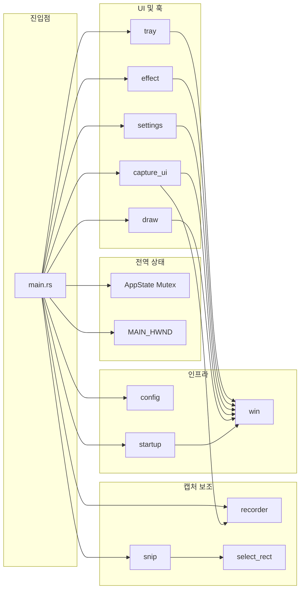
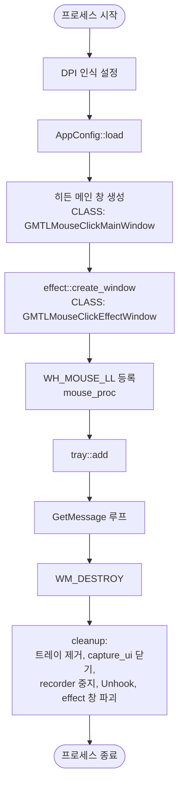
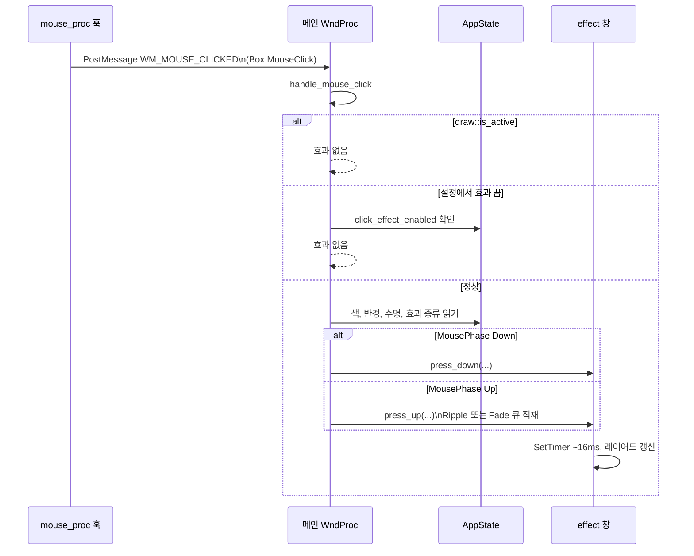
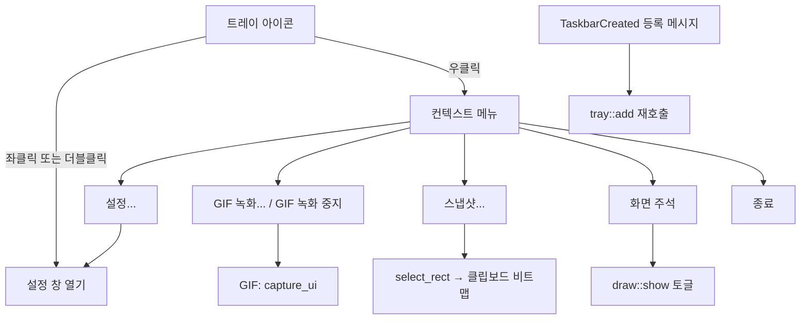

# GMTL Mouse Click — 동작 구조 및 기능 사양 (상세설계)

> **대상 코드**: Rust + `windows-sys` 기반 Win32 네이티브 앱. 패키지 `gmtl-mouse-click` (예: `version = "0.1.12"` — [Cargo.toml](../Cargo.toml) 기준).  

---

## 1. 목적 및 범위

### 1.1 목적

- **마우스 클릭 위치**에 시각적 피드백(연못 파장·페이드 등)을 가볍게 표시한다.
- **작업 표시줄 트레이**에 상주하며, 설정·GIF 화면 녹화·영역 스냅샷·화면 주석(드로우) 등 부가 기능을 제공한다.

### 1.2 런타임 특성

- `#![windows_subsystem = "windows"]` — 콘솔 없이 GUI 전용 프로세스.
- **DPI**: `SetProcessDpiAwarenessContext(PER_MONITOR_AWARE_V2)` 우선, 실패 시 `SetProcessDPIAware` 폴백 ([`src/main.rs`](../src/main.rs)).
- **저장 경량화**: 단일 실행 파일·무설치(포터블) 지향, 외부 웹뷰/런타임 없음.

---

## 2. 모듈·책임 (구조)

| 모듈 | 역할 요약 |
|------|-----------|
| `main` | 히든 메인 창, 메시지 루프, `WH_MOUSE_LL` 훅, `WM_MOUSE_CLICKED` 처리, 정리(`cleanup`) |
| `tray` | 알림 영역 아이콘, 컨텍스트 메뉴, `TaskbarCreated` 시 재등록 |
| `effect` | 레이어드 풀스크린 투명 오버레이, 타이머 기반 렌더(약 16ms 간격) |
| `settings` | 탭형 설정 창(기본/마우스/정보), `AppConfig` 편집·저장 유도 |
| `config` | `config.json` 로드·저장, `AppConfig` 필드 및 클램프 |
| `startup` | `HKCU\...\Run`에 실행 경로 등록/삭제("GMTL Mouse Click") |
| `capture_ui` | GIF 녹화용 선택 프레임·툴바 창, 녹화 시작/중지 UI |
| `recorder` | 별 스레드에서 화면(BitBlt)·선택적 타임스탬프·GIF 인코딩 |
| `snip` | `select_rect`로 영역 선택 후 비트맵을 클립보드에放置 |
| `select_rect` | 전체 가상 화면 위 드래그 선택 오버레이(Esc 취소) |
| `draw` | 화면 스냅 기반 레이어 주석(도형·블러 등), `is_active()`로 클릭 효과 억제 |
| `win` | WCHAR 변환, 리소스 ID, 공통 Win32 유틸 |

---

## 3. 기동~종료 생명주기

---

## 4. 마우스 클릭 시각화 시퀀스

### 4.1 훅·메시지 규약

- **대상 메시지**: `WM_LBUTTONDOWN` / `WM_LBUTTONUP` / `WM_RBUTTONDOWN` / `WM_RBUTTONUP`만 메인 스레드로 전달.
- **좌표**: `MSLLHOOKSTRUCT.pt`(스크린 좌표).
- **사용자 메시지**: `WM_MOUSE_CLICKED = WM_APP + 2`, 포인터는 힙에 올린 `MouseClick` 박스(메인에서 해제).

### 4.2 효과 창 (`effect`)

- **클래스명**: `GMTLMouseClickEffectWindow`
- **스타일**: `WS_EX_LAYERED | WS_EX_TRANSPARENT | WS_EX_TOPMOST | WS_EX_TOOLWINDOW | WS_EX_NOACTIVATE`, `WS_POPUP`
- **동작**: `press_down`에서 버튼별 **눌림** 상태(`Press`) 표시; `press_up`에서 **Ripple**은 링 확장 애니메이션, 그 외 `ClickEffectKind`는 **Fade** 큐에 페이드아웃.
- **타이머**: `TIMER_INTERVAL_MS = 16`(약 60Hz). 활성 효과가 없으면 타이머 종료 및 창 숨김.

### 4.3 클릭 효과 종류 (`ClickEffectKind`)

설정 UI 표시명([`settings.rs`](../src/settings.rs) 콤보 순서)과 구현 대응([`effect.rs`](../src/effect.rs) `draw_static_effect`):

| 열거값 | 설정 창 이름 | 구현 요약 |
|--------|--------------|-----------|
| `Ripple` | 물결파장 | 링 반경 확대(Up 시); Down은 작은 고정 반경 눌림 표시 |
| `FilledFade` | 채워진 원 페이드 | 원 디스크 채우기 페이드 |
| `FilledCrossFade` | 뚫린 십자 페이드 | 원 + 십자형 투명(컷아웃) 페이드 |
| `ArcFade` | 원호 페이드 | 링 형태 페이드 |
| `ArcDotFade` | 원호와 점 페이드 | 링 + 중심 점 페이드 |
| `CrossFade` | 십자 페이드 | 수직·수평 십자 |
| `XCrossFade` | X자 페이드 | 대각선 교차 |

---

## 5. 트레이·사용자 기능 분기

- **메뉴 위치**: 커서 기준, 화면 하단·작업 표시줄 근처에서 위로 펼침 보정([`tray.rs`](../src/tray.rs)).
- **GIF 항목 레이블**: `recorder::is_recording()`에 따라 "GIF 녹화 중지" / "GIF 녹화..." 전환.

---

## 6. GIF 녹화 (`capture_ui` + `recorder`)

### 6.1 흐름 요약

1. 트레이에서 녹화 선택 → 메인이 `capture_ui::show` 호출(이미 열려 있으면 포커스만).
2. **`GMTLCaptureUI`** 팝업: 선택 사각형(`RECT sel`), 상·하단 툴바, 녹화/취소, 프리셋·비율 콤보 등.
3. 녹화 시작 시 파일명 `gif-YYYYMMDD-HHMMSS.gif`, 폴더는 설정의 `gif_output_path`.
4. 캡처 영역은 프레임 내부에서 `BORDER`(4px) 안쪽 픽셀; `gif_even_size` 켜면 출력 가로·세로를 짝수로 보정.
5. **`recorder::start`**: 백그라운드 스레드에서 약 **100ms 간격(10 FPS)** 으로 프레임 캡처, `gif` 크레이트로 인코딩, 종료 시 flush.
6. 중지 후 `TIMER_POLL`(200ms)로 녹화 스레드 종료 폴링 → UI 복구; **취소** 또는 **프레임 0**이면 출력 파일 삭제.
7. `open_folder_after_save`이면 `ShellExecuteW`로 저장 폴더 탐색기 실행.

### 6.2 프레임·오버레이

- 화면 `BitBlt` + 커서가 영역 안이면 `DrawIcon` 합성.
- `show_gif_timestamp` 시 경과 시간 문자열을 프레임에 그린 뒤 GIF로 기록.

---

## 7. 스냅샷 (`snip`)

- `select_rect::select_region(owner)`로 `RECT` 획득(최소 변 길이 8px 등 [`select_rect.rs`](../src/select_rect.rs) 규칙).
- **영역 복사 실패** 시 소유자 기준 메시지 박스.
- **성공 시** 클립보드 `CF_BITMAP` — 비트맵 핸들 소유권은 OS에 이전.

---

## 8. 화면 주석 (`draw`)

### 8.1 개요

- **클래스명**: `GMTLDrawOverlay`
- 가상 스크린 전체 크기 레이어 창; 배경은 `CAPTUREBLT` 등으로 초기 화면 캡처 후 비트맵 위에 합성.
- **`draw::show`**: 이미 열려 있으면 해당 창 파괴(토글 닫기).
- **종료**: `Esc` 또는 다시 메뉴에서 호출 시 닫힘.
- **클릭 효과 상호 배제**: `draw::is_active()`이면 `handle_mouse_click`에서 즉시 반환.

### 8.2 도구·입력 (요약)

| 조합 | 도구 |
|------|------|
| (기본) | 자유 곡선 |
| Ctrl | 직선 |
| Shift | 사각형 테두리 |
| Tab | 타원 테두리 |
| Ctrl+Shift | 화살표 |
| `X` 키 누름 | 블러(스모크) 스트로크 |
| Ctrl+마우스 휠 | 펜 두께 2~40 |
| Ctrl+Z | 실행 취소(최대 32단계) |
| `R,G,B,Y,O,P,W,K` (+ Shift로 반투명 variant) | 팔레트 색 |

펜 기본 두께 5, 블러 최소 폭 12.

---

## 9. 설정 (`AppConfig`) 및 저장

### 9.1 파일·레지스트리

| 항목 | 위치 |
|------|------|
| JSON 설정 | `%APPDATA%\GMTL Mouse Click\config.json`(없으면 `LOCALAPPDATA`, 폴백 `cwd`) |
| Windows 시작 프로그램 | `HKCU\Software\Microsoft\Windows\CurrentVersion\Run`, 값 이름 `GMTL Mouse Click` |

### 9.2 필드 및 범위 ([`config.rs`](../src/config.rs))

| 필드 | 설명 | 기본·범위 등 |
|------|------|----------------|
| `left_click_color` / `right_click_color` | RGB | 기본 (0,150,255) / (255,96,96) |
| `click_effect_enabled` | 클릭 효과 사용 여부 | 기본 true |
| `start_with_windows` | 로그인 시 실행 | 기본 false |
| `ripple_radius` | 최대 링 반경 등 | 20~240, 기본 72 |
| `ripple_lifetime` | 애니메이션 길이(틱 단위, 효과 타이머와 연동) | 10~60, 기본 28 |
| `click_effect_kind` | 효과 종류 | 기본 `Ripple` |
| `gif_output_path` | GIF 저장 폴더 | 기본 `%USERPROFILE%\Downloads` |
| `open_folder_after_save` | 저장 후 탐색기 | 기본 false |
| `show_gif_timestamp` | GIF에 경과 시간 | 기본 false |
| `gif_timestamp_font_size` | 8~24, 기본 14 | |
| `gif_even_size` | 출력 해상도 짝수 보정 | 기본 true |
| `recent_left_colors` / `recent_right_colors` | 최근 색(저장 시 최대 3개로 truncate) | |

### 9.3 설정 창 동작 ([`settings.rs`](../src/settings.rs))

- **탭**: 기본(일반), 마우스, 정보.
- **버튼**:
  - **확인**: 현재 페이지 동기화 → `apply_settings` 성공 시 창 닫기.
  - **적용**: 동기화·저장만, 창 유지.
  - **취소**: 저장 없이 닫기.
  - **초기화**: UI를 `AppConfig::default()`로 되돌림(디스크 저장은 별도; 확인/적용 시 저장).
- **마우스 페이지**: 효과 사용 체크, 종류 콤보, 좌/우 색(HEX 편집·색상 대화상자), 반경·속도 슬라이더, 좌우별 최근 색 스와치(클릭 시 적용).
- **소유 창**: 열릴 때 메인(`owner`) 비활성화, 닫을 때 복구.

### 9.4 `apply_settings` ([`main.rs`](../src/main.rs))

1. `startup::set_enabled(start_with_windows)`
2. `config.save()`
3. `config.clamp_values()`
4. `APP_STATE` 내 `config` 갱신

---

## 10. 창 클래스 이름 일람

| 클래스 | 용도 |
|--------|------|
| `GMTLMouseClickMainWindow` | 메시지 허브, 훅 타깃 |
| `GMTLMouseClickEffectWindow` | 클릭 효과 오버레이 |
| `GMTLMouseClickSettingsWindow` | 설정 |
| `GMTLCaptureUI` | GIF 녹화 프레임 UI |
| `GMTLSelectRectangle` | 드래그 영역 선택 |
| `GMTLDrawOverlay` | 화면 주석 |

---

## 11. 제약·비기능적 동작

- **멀티 모니터**: 가상 스크린 메트릭(`SM_XVIRTUALSCREEN` 등) 사용.
- **보안 소프트웨어**: 저수준 마우스 훅은 정책/권한에 따라 실패할 수 있음(실패 시 메시지 박스 후 훅 NULL 가능).
- **성능**: 드로우·GIF는 픽셀 루프/캡처 부하가 큼; 고해상도·장시간 녹화 시 CPU·파일 크기 증가.
- **오류 UI**: 주요 실패는 `MessageBoxW`로 사용자 통지.

---

## 12. 소스 맵 (구현 추적용)

| 관심사 | 파일 |
|--------|------|
| 진입·훅·정리 | [main.rs](../src/main.rs) |
| 트레이 | [tray.rs](../src/tray.rs) |
| 효과 렌더 | [effect.rs](../src/effect.rs) |
| 설정 UI·저장 호출 | [settings.rs](../src/settings.rs) |
| 설정 스키마 | [config.rs](../src/config.rs) |
| 시작 프로그램 | [startup.rs](../src/startup.rs) |
| GIF UI | [capture_ui.rs](../src/capture_ui.rs) |
| GIF 인코딩 | [recorder.rs](../src/recorder.rs) |
| 스냅샷 | [snip.rs](../src/snip.rs), [select_rect.rs](../src/select_rect.rs) |
| 드로우 | [draw.rs](../src/draw.rs) |

---

*문서는 저장소의 현재 구현을 기준으로 작성되었습니다. 동작 변경 시 본 문서와 코드를 함께 갱신하세요.*
