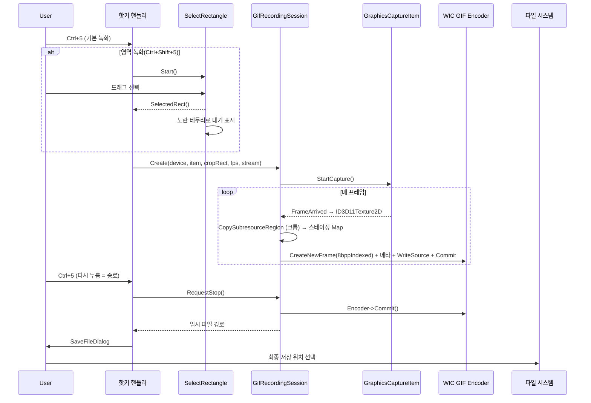
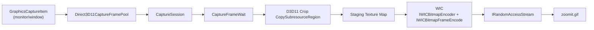

# 사양 04 — 화면 녹화 (GIF, ZoomIt-style Record)

> 이 문서 하나만으로 ZoomIt의 GIF 녹화 기능과 동등한 동작을 처음부터 구현할 수 있도록 작성되었습니다. 구현 언어는 Rust를 1순위로 전제하며, Windows.Graphics.Capture + Direct3D 11 + WIC 연동은 `windows` 크레이트 기반으로 설계합니다.

---

## 1. 목표 및 범위

데스크톱의 한 모니터, 한 윈도우, 또는 사용자가 드래그로 지정한 사각 영역을 **GIF 애니메이션 파일로 녹화**한다. 녹화는 단축키 토글로 시작/종료하며, 종료 후 사용자가 저장 경로를 선택하면 임시 파일을 그곳으로 옮긴다.

본 사양에서 다루는 범위:

- 모니터/윈도우/크롭 영역 단위 캡처.
- 일정 FPS로 프레임 수집(누락 시 직전 프레임 복제).
- WIC GIF 인코더로 프레임마다 8bpp 인덱스 컬러 인코딩.
- `NETSCAPE2.0` Application Extension으로 무한 루프.
- 영역 시각화/선택 컴포넌트 `SelectRectangle`(사양 05와 공유).

## 2. 기술 스택 / 권장 언어

- **1순위 권장**: Rust 2021 이상 + `windows` 크레이트로 Windows.Graphics.Capture, Direct3D 11, WIC API 호출.
- 참고 구현 스택: C++/WinRT (`winrt/Windows.Graphics.Capture.h` 등) + Direct3D 11 + Windows Imaging Component(WIC). 문서의 C++/WinRT 의사 코드는 API 호출 순서와 수명 관리를 설명하기 위한 참고용이다.
- 참고 컴파일러: MSVC v143 이상 (`/std:c++17` 또는 c++20), C++/WinRT는 NuGet `Microsoft.Windows.CppWinRT` 또는 SDK 내장.
- 헤더/라이브러리:
  - `<d3d11_4.h>`, `<dxgi1_6.h>`
  - `<wincodec.h>` (WIC), `windowscodecs.lib`
  - `<shcore.h>` (`CreateStreamOverRandomAccessStream`)
  - `winrt/Windows.Graphics.Capture.h`, `winrt/Windows.Graphics.DirectX.Direct3D11.h`
  - `winrt/Windows.Storage.Streams.h`
- 헬퍼(선택, 권장): [robmikh.common](https://github.com/robmikh/robmikh.common) — `CreateD3D11Device`, `CreateCaptureItemForMonitor`, `CreateCaptureItemForWindow`, `CreateDirect3DDevice` 등 보일러플레이트 단축.

## 3. 사용자 흐름



## 4. 기능 요구사항

- [ ] 핫키 토글로 시작/종료. 토글 키와 영역(Shift) / 윈도우(Alt) 변형 키.
- [ ] 캡처 대상: 모니터(기본) / 사용자 영역(드래그) / 활성 윈도우.
- [ ] 사용자 영역은 `SelectRectangle`로 시각적으로 표시(노란 테두리 + 반투명 외곽).
- [ ] 녹화 시작 후 `SelectRectangle`은 빨간 두꺼운 테두리로 변경(녹화 중 표시).
- [ ] 사용자 지정 FPS (기본 15). 정확히 1000/FPS ms 간격 시도, 새 프레임이 없으면 직전 프레임 복제.
- [ ] 출력은 단일 GIF 파일. 무한 루프(NETSCAPE2.0).
- [ ] 프레임 크기를 사용자 스케일링 옵션(예: 100%, 75%, 50%)에 맞춰 다운샘플(WIC `IWICBitmapScaler`).
- [ ] 스케일된 결과 너비/높이는 짝수로 보정(GIF가 짝수 강제는 아니지만 다른 도구 호환을 위해 권장).
- [ ] 마우스 커서 포함/제외 옵션.
- [ ] 캡처 면역(`WDA_EXCLUDEFROMCAPTURE`) — 자기 자신 UI(SelectRectangle 등)는 캡처되지 않게.
- [ ] 녹화 종료 시 0프레임이면 파일을 만들지 않음.
- [ ] 녹화 도중 `RequestStop()` 호출 즉시 안전하게 종료(인코더 락 + atomic 플래그).

## 5. 비기능 요구사항

- **CPU/메모리**: 4K 30fps GIF는 WIC의 8bpp 디더링이 단일 스레드에서 무거움 → 사양은 "가능하다면 CPU 코어를 활용해 프레임 인코딩을 직렬 큐에 비동기"로 권장. 적어도 1080p 15fps에서는 60초 녹화가 RAM 1GB 이내로 끝나야 함.
- **드롭 정책**: 인코더가 못 따라가면 새 프레임을 버리지 말고 직전 프레임을 GIF에 추가(시각적 끊김 < 메모리 폭증).
- **정확한 타이밍**: 각 프레임의 GIF Delay 메타데이터는 100분의 1초 단위. 15fps → Delay = 7 (실제 6.66의 반올림).
- **스레드 안전**: 캡처 콜백은 비동기 스레드. 인코더 접근은 mutex로 직렬화.
- **취소 안전**: `Close()`는 idempotent이어야 하며 두 번 호출되어도 누수/크래시 없음.

## 6. 아키텍처 / 데이터 흐름



## 7. 핵심 API / 의존성 표

### 7.1 캡처

| API | 역할 |
|---|---|
| `winrt::Windows::Graphics::Capture::GraphicsCaptureItem` | 캡처 대상(모니터/창) 핸들 |
| `Direct3D11CaptureFramePool::CreateFreeThreaded(device, B8G8R8A8UIntNormalized, 1, size)` | 프리스레드 프레임 풀 |
| `framePool.CreateCaptureSession(item)` | 세션 |
| `session.StartCapture()` / `Close()` | 시작/종료 |
| `framePool.FrameArrived(...)` | 프레임 도착 콜백 |
| `frame.Surface()` → `IDirect3DSurface` → `IDirect3DDxgiInterfaceAccess::GetInterface(IID_PPV_ARGS(&texture))` | D3D11 텍스처 추출 |
| `IsCursorCaptureEnabled` (속성, API 존재 시) | 커서 포함 토글 |
| `IsBorderRequired` (속성, API 존재 시) | 노란 캡처 테두리 표시 토글 |

### 7.2 D3D11 크롭

| API | 역할 |
|---|---|
| `D3D11CreateDevice(D3D_DRIVER_TYPE_HARDWARE, ..., D3D11_CREATE_DEVICE_BGRA_SUPPORT, ...)` | 디바이스 생성 |
| `ID3D11DeviceContext::CopySubresourceRegion` | 캡처 텍스처에서 크롭 영역만 복사 |
| `D3D11_TEXTURE2D_DESC` `Usage = D3D11_USAGE_STAGING`, `CPUAccessFlags = D3D11_CPU_ACCESS_READ` | CPU에서 읽을 수 있는 스테이징 텍스처 |
| `Map(D3D11_MAP_READ)` / `Unmap` | 픽셀 접근 |

### 7.3 인코딩(WIC)

| API | 역할 |
|---|---|
| `CoCreateInstance(CLSID_WICImagingFactory, ...)` | 팩토리 |
| `IWICImagingFactory::CreateStream` + `InitializeFromIStream` | WIC 스트림 |
| `IWICImagingFactory::CreateEncoder(GUID_ContainerFormatGif)` → `Initialize(WICBitmapEncoderNoCache)` | GIF 인코더 |
| `encoder->GetMetadataQueryWriter` | 컨테이너 메타데이터 (NETSCAPE2.0 루프) |
| `encoder->CreateNewFrame` → `frameEncode->Initialize` → `SetSize` → `SetPixelFormat(GUID_WICPixelFormat8bppIndexed)` | 프레임 인코더 |
| `frameEncode->GetMetadataQueryWriter` → `/grctlext/Delay`, `/grctlext/Disposal` | 그래픽 컨트롤 익스텐션 |
| `factory->CreateBitmapFromMemory(w,h, GUID_WICPixelFormat32bppBGRA, stride, size, pixels, &bitmap)` | 메모리 → BitmapSource |
| `factory->CreateBitmapScaler` → `Initialize(source, w', h', WICBitmapInterpolationModeFant)` | 다운샘플 |
| `frameEncode->WriteSource` → `Commit` | 프레임 기록 |
| `encoder->Commit` | 컨테이너 마감 |

### 7.4 스트림 어댑터

| API | 역할 |
|---|---|
| `winrt::Windows::Storage::Streams::IRandomAccessStream` | WinRT 스트림 |
| `CreateStreamOverRandomAccessStream(IRandomAccessStream*, IID_IStream, ...)` | WinRT ↔ COM `IStream` 어댑터 (`shcore.h`, `shcore.lib`) |

## 8. 핵심 클래스/함수 시그니처

```cpp
// 캡처 프레임 대기 헬퍼 (WaitForMultipleObjectsEx로 다음 프레임/종료 시그널 대기)
class CaptureFrameWait {
public:
    CaptureFrameWait(winrt::IDirect3DDevice const& device,
                     winrt::GraphicsCaptureItem const& item,
                     winrt::SizeInt32 const& size);
    // 종료 신호 또는 새 프레임이 도착할 때까지 블록.
    // 반환: 새 프레임이면 ID3D11Texture2D, 종료면 nullptr.
    winrt::com_ptr<ID3D11Texture2D> WaitForNextFrame();
    void RequestStop();
    void EnableCursorCapture(bool enable);
private:
    HANDLE m_nextFrameEvent;
    HANDLE m_endEvent;
    winrt::Direct3D11CaptureFramePool m_framePool{ nullptr };
    winrt::GraphicsCaptureSession      m_session{ nullptr };
    // FrameArrived 콜백에서 m_nextFrameEvent를 SetEvent
};
```

```cpp
// GIF 녹화 세션 — 사용자 진입점
class GifRecordingSession : public std::enable_shared_from_this<GifRecordingSession> {
public:
    [[nodiscard]] static std::shared_ptr<GifRecordingSession> Create(
        winrt::IDirect3DDevice const&         device,
        winrt::GraphicsCaptureItem const&     item,
        RECT const&                           cropRect,    // 캡처 좌표계 기준
        uint32_t                              frameRate,   // 기본 15
        winrt::IRandomAccessStream const&     stream);     // 출력

    // 비동기적으로 녹화 시작(루프). 사용자는 외부에서 RequestStop() 호출.
    winrt::IAsyncAction StartAsync();

    void EnableCursorCapture(bool enable = true);
    void Close(); // idempotent
    bool HasCapturedFrames() const;

private:
    GifRecordingSession(...);
    void CloseInternal();
    void ReleaseEncoderResources();
    HRESULT EncodeFrame(ID3D11Texture2D* tex);

    winrt::IDirect3DDevice               m_device{ nullptr };
    winrt::com_ptr<ID3D11Device>         m_d3dDevice;
    winrt::com_ptr<ID3D11DeviceContext>  m_d3dContext;

    RECT       m_rcCrop{};
    uint32_t   m_frameRate = 15;
    uint32_t   m_frameDelay = 0;     // 1/100 초 단위
    uint32_t   m_frameWidth = 0;
    uint32_t   m_frameHeight = 0;
    uint32_t   m_frameCount = 0;
    int32_t    m_width = 0;
    int32_t    m_height = 0;

    winrt::GraphicsCaptureItem            m_item{ nullptr };
    winrt::GraphicsCaptureItem::Closed_revoker m_itemClosed;
    std::shared_ptr<CaptureFrameWait>     m_frameWait;
    winrt::IRandomAccessStream            m_stream{ nullptr };

    winrt::com_ptr<IWICImagingFactory>      m_wicFactory;
    winrt::com_ptr<IWICStream>              m_wicStream;
    winrt::com_ptr<IWICBitmapEncoder>       m_gifEncoder;
    winrt::com_ptr<IWICMetadataQueryWriter> m_encoderMetadataWriter;

    std::atomic<bool> m_isRecording{false};
    std::atomic<bool> m_closed{false};
    std::atomic<bool> m_encoderReleased{false};
    std::atomic<bool> m_hasAnyFrame{false};
    std::mutex        m_encoderMutex;
};
```

`enable_shared_from_this` 패턴을 사용해 `StartAsync` 코루틴이 비동기 진행 중에도 자기 수명을 안전하게 유지하게 한다.

## 9. 녹화 루프 의사 코드

```cpp
winrt::IAsyncAction GifRecordingSession::StartAsync() try {
    auto self = shared_from_this(); // 자기 수명 보호
    m_frameDelay = std::max<uint32_t>(1, 100 / m_frameRate); // 1/100s
    InitWicEncoderAndContainerMetadata(); // NETSCAPE2.0 루프, 글로벌 팔레트 등

    m_isRecording = true;
    auto interval = std::chrono::milliseconds(1000 / m_frameRate);

    winrt::com_ptr<ID3D11Texture2D> previous;
    while (m_isRecording.load() && !m_closed.load()) {
        auto frame = m_frameWait->WaitForNextFrame(); // nullptr면 종료
        if (!frame) break;

        // 새 프레임이 있으면 크롭, 없으면 previous 복제
        auto cropped = Crop(frame ? frame.get() : previous.get());
        winrt::check_hresult(EncodeFrame(cropped.get()));
        previous = cropped;
        m_hasAnyFrame = true;

        co_await winrt::resume_after(interval);
    }

    {
        std::lock_guard<std::mutex> g(m_encoderMutex);
        if (m_gifEncoder) winrt::check_hresult(m_gifEncoder->Commit());
        ReleaseEncoderResources();
    }
} catch (...) {
    Close();
    throw;
}
```

```cpp
HRESULT GifRecordingSession::EncodeFrame(ID3D11Texture2D* texture) {
    std::lock_guard<std::mutex> g(m_encoderMutex);
    if (m_encoderReleased.load()) return S_FALSE;

    // 1) 스테이징 → Map
    D3D11_TEXTURE2D_DESC desc{};
    texture->GetDesc(&desc);
    auto staging = CreateStagingLike(desc);
    m_d3dContext->CopyResource(staging.get(), texture);
    D3D11_MAPPED_SUBRESOURCE m{};
    winrt::check_hresult(m_d3dContext->Map(staging.get(), 0, D3D11_MAP_READ, 0, &m));

    // 2) WIC: 메모리 → BitmapSource
    winrt::com_ptr<IWICBitmap> source;
    winrt::check_hresult(m_wicFactory->CreateBitmapFromMemory(
        desc.Width, desc.Height,
        GUID_WICPixelFormat32bppBGRA,
        m.RowPitch,
        desc.Height * m.RowPitch,
        static_cast<BYTE*>(m.pData),
        source.put()));

    // 3) 다운샘플(필요 시)
    winrt::com_ptr<IWICBitmapSource> finalSource = source.try_as<IWICBitmapSource>();
    auto [tw, th] = ComputeTargetSize(desc.Width, desc.Height); // 짝수 보정 포함
    if (tw != desc.Width || th != desc.Height) {
        winrt::com_ptr<IWICBitmapScaler> scaler;
        winrt::check_hresult(m_wicFactory->CreateBitmapScaler(scaler.put()));
        winrt::check_hresult(scaler->Initialize(source.get(), tw, th,
            WICBitmapInterpolationModeFant));
        finalSource = scaler;
    }

    // 4) 새 프레임 인코더
    winrt::com_ptr<IWICBitmapFrameEncode> frame;
    winrt::com_ptr<IPropertyBag2>         bag;
    winrt::check_hresult(m_gifEncoder->CreateNewFrame(frame.put(), bag.put()));
    winrt::check_hresult(frame->Initialize(bag.get()));
    winrt::check_hresult(frame->SetSize(tw, th));
    auto pf = GUID_WICPixelFormat8bppIndexed;
    winrt::check_hresult(frame->SetPixelFormat(&pf));

    // 5) Graphic Control Extension (Delay/Disposal)
    winrt::com_ptr<IWICMetadataQueryWriter> meta;
    winrt::check_hresult(frame->GetMetadataQueryWriter(meta.put()));
    SetMetaUShort(meta, L"/grctlext/Delay", static_cast<USHORT>(m_frameDelay));
    SetMetaUChar(meta,  L"/grctlext/Disposal", 0);

    // 6) 쓰기 + 커밋
    winrt::check_hresult(frame->WriteSource(finalSource.get(), nullptr));
    winrt::check_hresult(frame->Commit());

    m_d3dContext->Unmap(staging.get(), 0);
    ++m_frameCount;
    return S_OK;
}
```

## 10. 컨테이너 메타데이터 (NETSCAPE2.0 무한 루프)

```cpp
void GifRecordingSession::InitWicEncoderAndContainerMetadata() {
    winrt::check_hresult(CoCreateInstance(CLSID_WICImagingFactory, nullptr, CLSCTX_INPROC_SERVER,
                                          IID_PPV_ARGS(m_wicFactory.put())));
    winrt::check_hresult(m_wicFactory->CreateStream(m_wicStream.put()));

    winrt::com_ptr<IStream> com;
    winrt::check_hresult(CreateStreamOverRandomAccessStream(
        winrt::get_unknown(m_stream), IID_PPV_ARGS(com.put())));
    winrt::check_hresult(m_wicStream->InitializeFromIStream(com.get()));

    winrt::check_hresult(m_wicFactory->CreateEncoder(GUID_ContainerFormatGif, nullptr, m_gifEncoder.put()));
    winrt::check_hresult(m_gifEncoder->Initialize(m_wicStream.get(), WICBitmapEncoderNoCache));
    winrt::check_hresult(m_gifEncoder->GetMetadataQueryWriter(m_encoderMetadataWriter.put()));

    // /appext/Application = "NETSCAPE2.0", /appext/Data = {3, 1, loop_lo, loop_hi, 0}
    PROPVARIANT app{}; PropVariantInit(&app);
    app.vt = VT_UI1 | VT_VECTOR;
    BYTE appName[] = { 'N','E','T','S','C','A','P','E','2','.','0' };
    app.caub.cElems = sizeof(appName); app.caub.pElems = appName;
    winrt::check_hresult(m_encoderMetadataWriter->SetMetadataByName(L"/appext/Application", &app));

    PROPVARIANT data{}; PropVariantInit(&data);
    data.vt = VT_UI1 | VT_VECTOR;
    BYTE loop[] = { 3, 1, 0x00, 0x00, 0 }; // 0x0000 = 무한 반복
    data.caub.cElems = sizeof(loop); data.caub.pElems = loop;
    winrt::check_hresult(m_encoderMetadataWriter->SetMetadataByName(L"/appext/Data", &data));
}
```

## 11. 영역 선택/표시 — `SelectRectangle`

녹화에서는 다음 두 단계로 사용한다.

1. **영역 녹화 모드일 때**: `SelectRectangle::Start(owner, /*fullMonitor*/false)` → 사용자가 드래그로 사각형 선택 → `SelectedRect()`로 캡처 좌표계 RECT 회수.
2. **녹화 시작 직후**: `SetRecordingActive()` 호출 → 노란색 얇은 테두리에서 빨간색 두꺼운 테두리로 변경, 자기 자신은 `SetExcludeFromCapture(true)`로 캡처에서 제외.

`SelectRectangle`의 정확한 공개 API는 사양 [05-zoomit-snip-spec.md](./05-zoomit-snip-spec.md) §11에 정의되어 있다. 두 사양은 같은 컴포넌트를 공유한다.

## 12. 입출력 계약

### 12.1 핫키 (권장 기본값)

| 핫키 | 동작 |
|---|---|
| `Ctrl+5` | 모니터 전체 녹화 시작/종료 |
| `Ctrl+Shift+5` | 영역 선택 후 녹화 시작/종료 |
| `Ctrl+Alt+5` | 활성 윈도우 녹화 시작/종료 |

핫키 ID는 단일 디스패처(예: 트레이 호스트, 사양 01)에 등록하고 다음과 같이 라우팅한다.

```cpp
constexpr int RECORD_HOTKEY        = 5;  // 모니터
constexpr int RECORD_CROP_HOTKEY   = 6;  // 영역
constexpr int RECORD_WINDOW_HOTKEY = 7;  // 창
```

### 12.2 출력

- 녹화 중 임시 파일: `%TEMP%\YourApp\record-<unix>.gif`.
- 종료 후 사용자에게 `IFileSaveDialog`(또는 `GetSaveFileNameW`) 표시 → 사용자가 선택한 경로로 `MoveFileExW(MOVEFILE_REPLACE_EXISTING)`.
- 0프레임이면 임시 파일 삭제 후 사용자에게 토스트로 알림.

### 12.3 설정창과의 결합 (사양 02 참조)

```jsonc
{
  "RecordToggleKey":  { "modifiers": ["Ctrl"], "key": "5" },
  "RecordFrameRate":  15,
  "RecordScaling":    100,        // 100/75/50 등 퍼센트
  "CaptureCursor":    true
}
```

`{"action":{"ZoomIt":{"action_name":"refresh_settings"}}}` 수신 시 진행 중인 녹화는 영향 받지 않고, 다음 시작 시점부터 반영한다.

## 13. 엣지 케이스

1. **API 부재**: Windows 10 19041 미만에서 `IsCursorCaptureEnabled` 등 일부 속성이 없음 → `Windows::Foundation::Metadata::ApiInformation::IsPropertyPresent`로 분기.
2. **HDR/광색역**: B8G8R8A8 포맷으로 캡처되므로 HDR 콘텐츠는 톤매핑 없이 SDR로 떨어진다(GIF 256색 한계와 일관).
3. **WGC 캡처가 검은 화면**: 권한/DRM 컨텐츠. 사용자에게 안내 토스트.
4. **WIC 8bpp 인코더 속도**: 4K에서 매우 느림 → 권장 해상도 한계(예: 2560 픽셀)를 사양 옵션에 포함.
5. **드롭 정책**: 인코더 큐가 N프레임 이상 적체되면 새 프레임을 스킵하지 말고 직전 프레임 복제(시각적 끊김 < 메모리 적체).
6. **GIF 파일 크기 폭증**: 60초 이상의 풀 컬러 화면은 수백 MB. 기본 스케일링 75% 권장.
7. **모니터 핫플러그**: `GraphicsCaptureItem.Closed` 이벤트로 즉시 종료 흐름.
8. **종료 동시성**: `RequestStop()`이 콜백 스레드와 사용자 스레드에서 동시에 호출되어도 안전해야 함(atomic + mutex).

## 14. 검증 체크리스트

- [ ] 핫키로 녹화가 시작되고 알림 영역/오버레이로 사용자에게 녹화 중임을 알림.
- [ ] 영역 모드에서 드래그한 영역만 GIF에 들어 있다.
- [ ] 윈도우 모드에서 해당 윈도우가 다른 창에 가려져도 녹화는 계속됨(WGC는 윈도우 단위 캡처를 지원).
- [ ] 종료 시 GIF가 무한 루프된다(브라우저에서 확인).
- [ ] 1080p 30초 기본 옵션으로 RAM 사용량이 안정적(폭주 없음).
- [ ] `RequestStop()` 직후 인코더가 안전하게 마감되고 파일이 손상되지 않는다.
- [ ] 0프레임으로 종료 시 빈 파일이 디스크에 남지 않는다.
- [ ] 자기 자신 UI(SelectRectangle, 트레이 메뉴)가 GIF에 보이지 않는다.

## 15. 이 문서를 LLM에 그대로 던질 때 추가로 첨부하면 좋은 정보

- 타깃 OS 최저 버전(Windows 10 1809 / 1903 / 19041 중 어디까지).
- 출력 파일 명명 규칙과 기본 저장 위치.
- 기본 스케일/FPS 정책(메모리 보호 우선 vs 화질 우선).

---

## 부록 A — `WaitForMultipleObjectsEx` 패턴

`CaptureFrameWait`는 다음 두 이벤트를 동시에 대기한다.

```cpp
HANDLE handles[2] = { m_nextFrameEvent, m_endEvent };
DWORD r = WaitForMultipleObjectsEx(2, handles, FALSE, INFINITE, FALSE);
if (r == WAIT_OBJECT_0 + 1) return nullptr; // end
// r == WAIT_OBJECT_0 → m_framePool.TryGetNextFrame() 호출
```

`FrameArrived`에서는 단순히 `SetEvent(m_nextFrameEvent)` 만 호출해 처리 스레드에 깨움 신호를 보낸다.

## 부록 B — 짝수 보정 / 권장 Resampling

```cpp
inline std::pair<uint32_t,uint32_t> EnsureEvenGif(uint32_t w, uint32_t h) {
    return { w & ~1u, h & ~1u };
}
```

`WICBitmapInterpolationModeFant`는 화질/속도 균형이 좋다. 더 빠른 미리보기 옵션이 필요하면 `WICBitmapInterpolationModeNearestNeighbor`.

## 부록 C — 관련 문서

- 영역 선택 컴포넌트 `SelectRectangle`의 전체 사양 → [05-zoomit-snip-spec.md](./05-zoomit-snip-spec.md)
- 단축키 디스패처 / 트레이 → [01-tray-icon-spec.md](./01-tray-icon-spec.md)
- 설정 UI → [02-settings-window-spec.md](./02-settings-window-spec.md)
