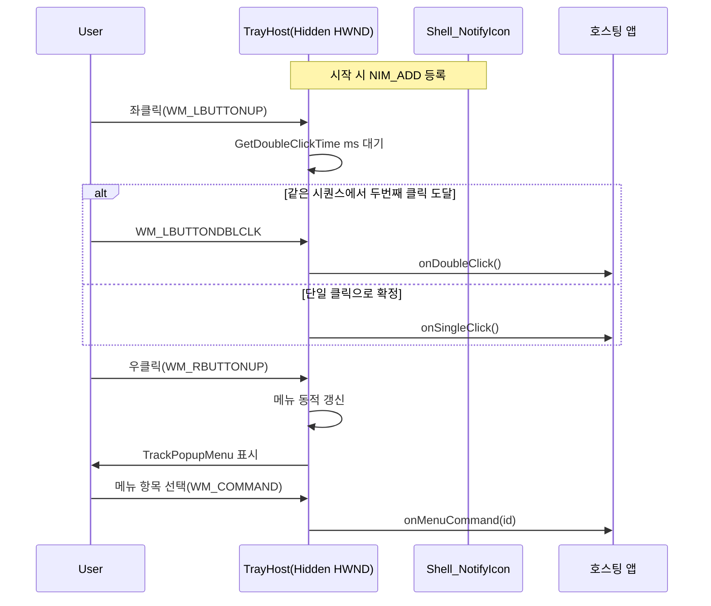
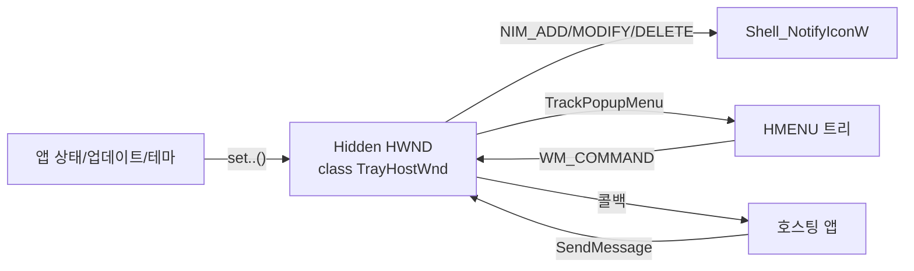

# 사양 01 — Windows 시스템 트레이 아이콘 (Tray Icon)

> 이 문서 하나만으로 동일한 동작의 트레이 아이콘 컴포넌트를 처음부터 구현할 수 있도록 작성되었습니다. 구현 언어는 Rust를 1순위로 전제하며, Win32 API는 `windows` 또는 `windows-sys` 크레이트로 직접 호출합니다.

---

## 1. 목표 및 범위

알림 영역(시스템 트레이)에 아이콘 하나를 띄우고, 메인 GUI 창은 별도로 두는 **백그라운드 호스트 애플리케이션**의 표준 트레이 UX를 제공한다. 다음을 만족해야 한다.

- 단일/더블 클릭을 구분해 각각 다른 동작을 호출.
- 우클릭 시 동적으로 갱신되는 컨텍스트 메뉴.
- Explorer가 재시작되어도 아이콘이 사라지지 않음(자가 복구).
- 외부 프로세스에서 메뉴 명령을 보낼 수 있는 IPC 채널 겸용.
- 라이트/다크 시스템 테마와 업데이트 가용 상태에 따라 아이콘 자동 교체.

이 컴포넌트 자체는 어떤 비즈니스 로직도 갖지 않는다. 메뉴 클릭 → "이 명령이 들어왔다"는 콜백만 외부에 알리는 **얇은 호스트**여야 한다.

## 2. 기술 스택 / 권장 언어

- **1순위 권장**: Rust 2021 이상 + `windows` 또는 `windows-sys` 크레이트로 Win32 API 직접 호출 (Shell, USER32, GDI).
- 참고 구현 스택: C++17 이상 Win32 API 직접 호출. 문서의 C++ 의사 코드는 Win32 호출 순서와 상태 구조를 설명하기 위한 참고용이다.
- 대안: C# (.NET 8+) + `Windows.Win32.Shell.NotifyIcon` P/Invoke. WPF나 WinForms의 `NotifyIcon` 추상화는 동적 메뉴/단일·더블 클릭 분리에서 한계가 있어 본 사양과 잘 맞지 않는다.
- 의존 라이브러리: 표준 Windows SDK만 사용. 제3자 라이브러리 금지.

## 3. 사용자 흐름 (UX 시나리오)



## 4. 기능 요구사항

- [ ] 트레이 아이콘은 정확히 하나만 등록한다(`uID = 1` 등 고정 ID).
- [ ] 툴팁 텍스트는 `NIF_TIP`으로 설정 가능.
- [ ] 좌클릭 단일 = 콜백 A, 좌클릭 더블 = 콜백 B (서로 다른 동작).
- [ ] 우클릭 또는 컨텍스트 메뉴 단축키(앱키, Shift+F10) → 메뉴 표시.
- [ ] 메뉴는 표시 직전마다 다음을 다시 계산한다.
  - 옵션 A: 특정 항목 활성/비활성(예: "버그 리포트 실행 중" 동안 회색 처리).
  - 옵션 B: 특정 항목 동적 삽입/삭제(예: 업데이트가 가능할 때 맨 위에 "업데이트 있음" 행 + 구분선 추가).
  - 옵션 C: 특정 항목의 라벨/아이콘 교체(예: 좌클릭 동작이 바뀌면 "Settings" 라벨이 "Settings (좌클릭)"로).
- [ ] 라이트/다크 시스템 테마 변경 시 아이콘 핸들 교체 후 `NIM_MODIFY`.
- [ ] "업데이트 가능" 상태가 켜지면 별도 변형(빨간 점 등) 아이콘으로 교체.
- [ ] 외부 프로세스가 트레이 호스트 창을 찾아(고정 윈도우 클래스명) `SendMessage(hwnd, WM_COMMAND, 메뉴ID, lparam)`으로 명령을 주입할 수 있음.
- [ ] 종료 명령을 받으면 `Shell_NotifyIcon(NIM_DELETE)` → `DestroyWindow` → `PostQuitMessage(0)`.
- [ ] Explorer가 죽었다가 살아나도 아이콘이 자동 복귀.

## 5. 비기능 요구사항

- **고DPI 안전**: 아이콘 로드는 다중 해상도 ICO/PNG에서 SHGetStockIconInfo 또는 `LoadIconWithScaleDown`(SHCore) 권장.
- **UIPI**: 현재 프로세스보다 낮은 무결성 수준 프로세스에서 보낸 `WM_COMMAND`도 받고 싶다면 `ChangeWindowMessageFilterEx(hwnd, WM_COMMAND, MSGFLT_ALLOW, nullptr)` 호출. 보안 정책이 그 반대라면 호출하지 않는다.
- **단일 인스턴스 정책**: About 다이얼로그 등 모달은 표시 중 플래그(`bool aboutShown`)로 중복 표시 방지.
- **스레드 안전**: 모든 UI 작업은 트레이 호스트 창의 메시지 루프 스레드에서 수행. 다른 스레드에서 트레이 상태 변경이 필요하면 별도 사용자 메시지(`WM_APP+1`)로 마샬링.
- **언어**: 메뉴 라벨은 모두 외부 리소스/리소스 매니저에서 가져와 i18n 가능.

## 6. 아키텍처 / 데이터 흐름



`TrayHostWnd`는 다음 2~3개의 사용자 메시지 채널을 사용한다.

| 메시지 ID | 용도 |
|---|---|
| `WM_APP` (`wm_icon_notify`) | `Shell_NotifyIcon` 콜백 (마우스/키보드 이벤트가 lParam에 실림) |
| `WM_APP + 1` (`wm_run_on_main_ui_thread`) | 다른 스레드의 람다/콜백을 메시지 루프에서 실행시키는 디스패처 |
| `RegisterWindowMessageW(L"TaskbarCreated")` | Explorer 재시작 감지 |

## 7. 핵심 API / 의존성 표

| 영역 | API |
|---|---|
| 트레이 등록 | `Shell_NotifyIconW`(`NIM_ADD` / `NIM_MODIFY` / `NIM_DELETE`), `NOTIFYICONDATAW`, 플래그 `NIF_ICON | NIF_TIP | NIF_MESSAGE`, 상태 `NIS_HIDDEN` |
| 창 클래스 | `RegisterClass`, `LoadCursor`, `CreateWindowW`, `DefWindowProc`, `DestroyWindow`, `PostQuitMessage` |
| 메시지 | `RegisterWindowMessageW("TaskbarCreated")`, `WM_APP`, `WM_COMMAND`, `WM_HOTKEY`(선택), `WM_LBUTTONUP`, `WM_LBUTTONDBLCLK`, `WM_RBUTTONUP`, `WM_CONTEXTMENU`, `WM_DESTROY`, `WM_CLOSE`, `WM_WINDOWPOSCHANGING` |
| 메뉴 | `LoadMenu`, `GetSubMenu`, `TrackPopupMenu`, `DestroyMenu`, `DeleteMenu`, `InsertMenuW`, `GetMenuItemCount`, `GetMenuItemInfoW`, `SetMenuItemInfoW`, `EnableMenuItem`, 플래그 `MF_BYCOMMAND`/`MF_GRAYED` 등 |
| 입력 보조 | `SetForegroundWindow`, `GetCursorPos`, `GetDoubleClickTime`, `SetTimer`/`KillTimer` |
| 아이콘 | `LoadIcon`(리소스), `LoadImage`(`LR_LOADFROMFILE | LR_DEFAULTSIZE | LR_SHARED`), `DestroyIcon` |
| UIPI | `ChangeWindowMessageFilterEx` |
| 시스템 테마 | `RegOpenKeyEx`/`RegNotifyChangeKeyValue` 또는 `WM_SETTINGCHANGE` 수신 후 `AppsUseLightTheme` 레지스트리 폴링 |

## 8. 핵심 클래스/함수 시그니처 (의사 코드, C++)

```cpp
// 외부에 노출되는 트레이 호스트의 공개 API (헤더)
namespace tray {
    using SingleClickCallback   = std::function<void()>;
    using DoubleClickCallback   = std::function<void()>;
    using MenuCommandCallback   = std::function<void(uint32_t commandId, LPARAM lparam)>;

    struct StartOptions {
        std::wstring  windowClassName  = L"YourAppTrayWnd"; // 외부에서 FindWindow로 찾기 위해 고정
        std::wstring  tipText          = L"Your App";
        HICON         normalIcon       = nullptr;
        HICON         updateIcon       = nullptr;
        bool          themeAdaptive    = false;
        SingleClickCallback   onSingleClick;
        DoubleClickCallback   onDoubleClick;
        MenuCommandCallback   onCommand;
        // 메뉴 표시 직전 호출되는 훅 — 여기서 동적 메뉴 갱신
        std::function<void(HMENU)> onBeforeShowMenu;
    };

    bool start(const StartOptions& options);
    void stop();
    void setIconUpdateAvailable(bool yes);   // NIM_MODIFY로 아이콘 교체
    void setVisible(bool visible);           // NIF_STATE | NIS_HIDDEN 토글 + NIM_MODIFY
    void setThemeAdaptive(bool enabled);
    bool dispatchOnUiThread(std::function<void()> work); // PostMessage(WM_APP+1)
    HWND hwnd();                             // 외부 IPC용 핸들 노출(테스트/디버그)
}
```

```cpp
// 핵심 윈도우 프로시저 골격
LRESULT CALLBACK TrayWndProc(HWND h, UINT m, WPARAM wp, LPARAM lp) {
    switch (m) {
    case WM_CREATE:
        wmTaskbarRestart = RegisterWindowMessageW(L"TaskbarCreated");
        return 0;
    case WM_WINDOWPOSCHANGING:
        // Explorer 부팅 중 NIM_ADD 실패 가능성 보강
        if (!g.created) g.created = Shell_NotifyIconW(NIM_ADD, &g.nid);
        return 0;
    case WM_DESTROY:
        if (g.created) Shell_NotifyIconW(NIM_DELETE, &g.nid);
        PostQuitMessage(0);
        return 0;
    case WM_COMMAND:
        if (g.opts.onCommand) g.opts.onCommand(LOWORD(wp), lp);
        return 0;
    default:
        if (m == g.wmIconNotify) return OnTrayCallback(h, wp, lp);
        if (m == wmTaskbarRestart) { Shell_NotifyIconW(NIM_ADD, &g.nid); return 0; }
        return DefWindowProc(h, m, wp, lp);
    }
}
```

```cpp
// 아이콘 콜백: 단일/더블 클릭 분리, 우클릭 메뉴
LRESULT OnTrayCallback(HWND h, WPARAM /*wp*/, LPARAM lp) {
    switch (LOWORD(lp)) {
    case WM_LBUTTONUP:
        if (!g.dblTimerRunning) {
            g.dblTimerRunning = true;
            g.doubleClicked   = false;
            // 권장: SetTimer로 GetDoubleClickTime() 만큼 후 만료 콜백
            SetTimer(h, kDoubleClickTimerId, GetDoubleClickTime(), nullptr);
        }
        return 0;
    case WM_LBUTTONDBLCLK:
        g.doubleClicked = true;
        if (g.opts.onDoubleClick) g.opts.onDoubleClick();
        return 0;
    case WM_RBUTTONUP:
    case WM_CONTEXTMENU:
        ShowContextMenu(h);
        return 0;
    }
    return 0;
}

case WM_TIMER: // kDoubleClickTimerId 만료
    KillTimer(h, kDoubleClickTimerId);
    g.dblTimerRunning = false;
    if (!g.doubleClicked && g.opts.onSingleClick) g.opts.onSingleClick();
    return 0;
```

```cpp
// 우클릭 메뉴 표시 — 표시 직전 동적 갱신 훅 호출
void ShowContextMenu(HWND h) {
    if (g.opts.onBeforeShowMenu) g.opts.onBeforeShowMenu(g.hSubMenu);
    POINT pt; GetCursorPos(&pt);
    SetForegroundWindow(h); // 메뉴가 즉시 닫히는 문제 회피
    TrackPopupMenu(g.hSubMenu,
        TPM_CENTERALIGN | TPM_BOTTOMALIGN,
        pt.x, pt.y, 0, h, nullptr);
}
```

## 9. UI 레이아웃 / 입력 매핑

### 기본 컨텍스트 메뉴 예시(외부 앱이 자유롭게 정의)

```
[업데이트 있음]                ← update_available일 때만 동적 삽입
─────────────                  ← 위 항목과 함께 삽입되는 구분선
대시보드 빠른 열기 (Left-click) ← 좌클릭 동작과 라벨 동기화 옵션
설정
─────────────
도움말
버그 리포트                    ← 실행 중이면 Grayed
─────────────
종료
```

### 입력 → 동작 매핑

| 입력 | 결과 |
|---|---|
| 좌클릭(단일, 확정 후) | `onSingleClick()` |
| 좌더블클릭 | `onDoubleClick()` |
| 우클릭 / Shift+F10 / 앱키 | 메뉴 표시 |
| 메뉴 항목 선택 | `onCommand(id, lparam)` |
| 외부 `SendMessage(WM_COMMAND, id, lp)` | 동일하게 `onCommand(id, lp)` 라우팅 |

## 10. 입출력 계약

### 외부 프로세스 ↔ 트레이 호스트

다른 프로세스(예: 본 앱의 메인 GUI 창)가 다음과 같이 명령을 주입할 수 있다.

```cpp
HWND tray = FindWindowW(L"YourAppTrayWnd", nullptr); // 클래스명 = StartOptions.windowClassName
if (tray) {
    // 예: ID_CLOSE_MENU_COMMAND를 보내 호스트 종료
    SendMessageW(tray, WM_COMMAND, ID_CLOSE_MENU_COMMAND, 0);
    // 예: ID_SETTINGS_MENU_COMMAND로 특정 페이지 열기 (lparam에 페이지 enum)
    PostMessageW(tray, WM_COMMAND, ID_SETTINGS_MENU_COMMAND, (LPARAM)PageEnum::Dashboard);
}
```

이 계약을 깨지 않으려면 윈도우 클래스명과 메뉴 ID 상수를 **공용 헤더(public contract)** 로 분리해 메인 GUI와 트레이 호스트가 모두 참조하게 한다.

### 메뉴 항목 ID 상수 권장 값

```cpp
constexpr UINT ID_CLOSE_MENU_COMMAND          = 40001;
constexpr UINT ID_SETTINGS_MENU_COMMAND       = 40002;
constexpr UINT ID_ABOUT_MENU_COMMAND          = 40003;
constexpr UINT ID_REPORT_BUG_COMMAND          = 40004;
constexpr UINT ID_DOCUMENTATION_MENU_COMMAND  = 40005;
constexpr UINT ID_QUICK_ACCESS_MENU_COMMAND   = 40006;
constexpr UINT ID_UPDATE_MENU_COMMAND         = 40007;
```

## 11. 엣지 케이스

1. **Explorer가 부팅 중**: 첫 `Shell_NotifyIcon(NIM_ADD)` 실패 → 트레이 미등록. 해결: `WM_WINDOWPOSCHANGING` 진입 시마다 `created` 플래그를 보고 재시도.
2. **Explorer 재시작**: `TaskbarCreated` 메시지 수신 시 무조건 `NIM_ADD` 다시.
3. **DPI 변경**: 모니터 이동/스케일 변경에서 아이콘 비율이 흐려질 수 있음 → 멀티 사이즈 ICO 사용 권장.
4. **About 등 모달의 중복 호출**: 단일 인스턴스 가드 플래그 필수.
5. **종료 시 핸들 누수**: `DestroyMenu(hMenu)` + `DestroyIcon(hIcon)` (`LR_SHARED`로 로드한 아이콘은 제외) + `Shell_NotifyIcon(NIM_DELETE)` 순서를 어기지 말 것.
6. **시스템 테마가 빠르게 토글**되는 데모: `WM_SETTINGCHANGE`(`lParam == "ImmersiveColorSet"`)에서 디바운싱 후 아이콘 교체.
7. **단일 클릭 vs 더블 클릭 경합**: 첫 `WM_LBUTTONUP` 처리 후 `GetDoubleClickTime` 안에 `WM_LBUTTONDBLCLK`이 도달하면 `doubleClicked=true`로 단일 클릭 콜백을 취소.

## 12. 검증 체크리스트

구현 후 다음을 통과해야 한다.

- [ ] 알림 영역에 아이콘이 즉시 보인다.
- [ ] Explorer 강제 종료(`taskkill /im explorer.exe`) 후 재실행 시 아이콘이 자동 복귀한다.
- [ ] 좌클릭 단일/더블이 다른 콜백을 호출한다(동시에 둘 다 호출되지 않는다).
- [ ] 우클릭 메뉴 표시 직전마다 `onBeforeShowMenu(hMenu)`가 호출되어 동적 갱신이 일어난다.
- [ ] 다른 프로세스가 `FindWindow + SendMessage(WM_COMMAND, ...)`로 종료/페이지 열기를 트리거할 수 있다(UIPI 정책에 부합).
- [ ] 라이트→다크→라이트 토글 시 아이콘이 모두 교체된다.
- [ ] 업데이트 가용 상태 토글 시 아이콘 변형 + 메뉴 상단에 "업데이트 있음" 항목 + 구분선이 동적으로 등장/사라진다.
- [ ] 종료 시 아이콘 잔상이 트레이에 남지 않는다.

## 13. 이 문서를 LLM에 그대로 던질 때 추가로 첨부하면 좋은 정보

LLM에게 의뢰 시 아래 항목을 본 사양 위에 추가로 기입하면 결과 품질이 크게 좋아진다.

- 타깃 OS 최저 버전 (예: Windows 10 1809 이상).
- 빌드 시스템 (MSBuild .vcxproj / CMake / .NET SDK).
- 메인 GUI 창의 존재 여부와 그 통신 방식 (예: "WPF 앱이며 명명 파이프 IPC 사용").
- 메뉴 라벨의 다국어 처리 방식 (`.rc` 문자열 테이블, `.resw`, JSON 등).
- 단일 인스턴스 강제 여부와 방식.
- 아이콘 자산 경로 또는 임베디드 리소스 ID.

---

## 부록 A — Win32 NotifyIcon 초기화 코드 골격

```cpp
NOTIFYICONDATAW nid = { sizeof(nid) };
nid.hWnd            = hiddenWnd;
nid.uID             = 1;                          // 호스트 내부 ID (고정)
nid.uCallbackMessage= WM_APP;                     // wm_icon_notify
nid.uFlags          = NIF_ICON | NIF_TIP | NIF_MESSAGE;
nid.hIcon           = currentIcon;
wcsncpy_s(nid.szTip, tipText.c_str(), _TRUNCATE);
Shell_NotifyIconW(NIM_ADD, &nid);
```

## 부록 B — 라이트/다크 적응형 아이콘 교체

```cpp
HICON PickIcon(bool darkMode, bool updateAvailable) {
    if (darkMode)  return updateAvailable ? iconWhiteUpdate : iconWhite;
    else           return updateAvailable ? iconDarkUpdate  : iconDark;
}

void OnSystemThemeChanged() {
    nid.hIcon = PickIcon(IsSystemDark(), updateAvailable);
    Shell_NotifyIconW(NIM_MODIFY, &nid);
}
```
