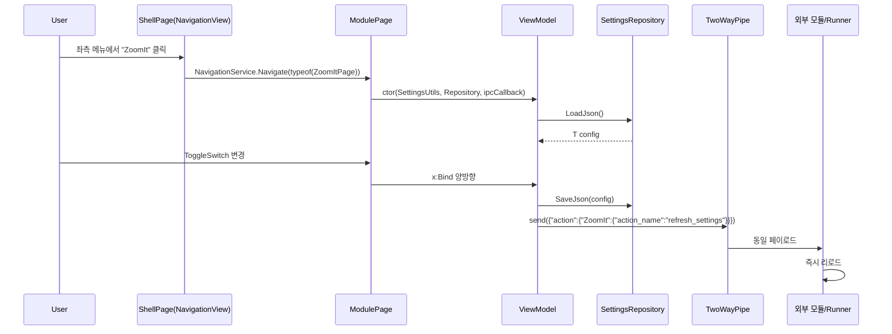
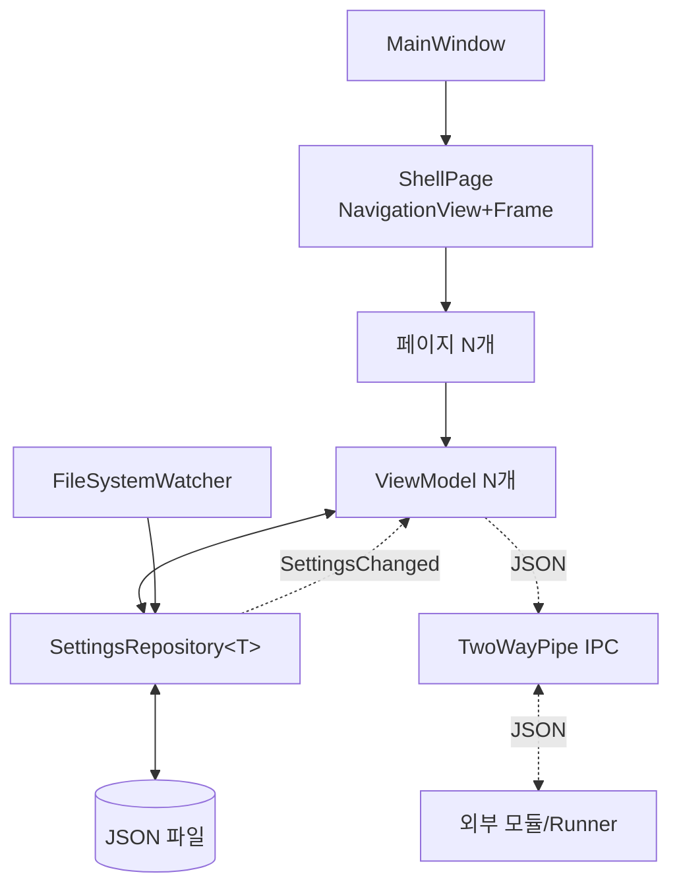

# 사양 02 — 설정창 (Settings Window) UI/UX

> 이 문서 하나만으로 동일한 동작·외관의 설정창을 처음부터 구현할 수 있도록 작성되었습니다. 구현 언어는 Rust를 1순위로 전제하며, Windows App SDK/WinUI 3 연동은 `windows` 크레이트 기반으로 설계합니다.

---

## 1. 목표 및 범위

여러 개의 독립 모듈/기능에 대한 설정을 한 창에서 관리하는 **데스크톱 설정 앱**의 표준 UX를 구현한다. 다음을 만족해야 한다.

- 좌측 카테고리 네비게이션 + 우측 페이지 컨텐츠.
- 각 모듈마다 별도 페이지, 페이지 내부는 카드/확장 카드 기반의 일관된 디자인.
- 토글, 슬라이더, 콤보박스, 단축키 입력기, 색상 선택, 마크다운 설명을 표준화된 컨트롤로 사용.
- 디스크에 JSON으로 영속화. 파일이 외부에서 변경되어도 UI가 자동 반영(파일 감시).
- 백그라운드에서 동작 중인 별도 프로세스(예: 트레이 호스트, 모듈 서비스)와 명명 파이프 IPC.
- 다국어/다크 테마/접근성 자동화 ID 일관 적용.
- 대시보드 / 일반 / 모듈별 페이지의 셸 구조가 변경 없이 새 모듈 페이지를 추가할 수 있도록 확장 가능.

본 사양에서 "모듈"은 설정 페이지가 한 개 있는 독립 기능을 가리킨다.

## 2. 기술 스택 / 권장 언어

- **1순위 권장**: Rust 2021 이상 + `windows` 크레이트로 Windows App SDK / WinUI 3 API 연동.
- 참고 구현 스택: C# 11 / .NET 8 + WinUI 3 (Microsoft.WindowsAppSDK 1.5+). 문서의 XAML/WinUI 구조 설명은 Rust 구현에서도 동일한 UX 계약으로 본다.
- 참고 NuGet
  - `Microsoft.WindowsAppSDK`
  - `CommunityToolkit.WinUI.Controls.SettingsControls` (SettingsCard, SettingsExpander)
  - `CommunityToolkit.WinUI.Controls.Primitives`
  - `CommunityToolkit.WinUI.Animations`
  - `CommunityToolkit.WinUI.Converters`
  - `CommunityToolkit.Labs.WinUI.Controls.MarkdownTextBlock` (선택)
  - `Microsoft.Xaml.Behaviors.WinUI.Managed` (Interaction Behaviors)
  - `WinUIEx` (창 확장; 시스템 백드롭/자가 위치 저장 등에 유용)
- 대안: WPF + Material Design — 가능하나 Settings 카드 룩앤필을 자체 제작해야 하므로 비권장.

## 3. 사용자 흐름



## 4. 기능 요구사항

- [ ] 좌측 `NavigationView`에 카테고리 헤더, 그 아래 자식 항목들이 트리 구조로 노출.
- [ ] 자식 항목 클릭 시 우측 `Frame`이 해당 페이지로 전환되며 같은 페이지 중복 네비게이션은 무시.
- [ ] 페이지 컨텐츠는 항상 `SettingsPageControl` (제목 + 모듈 이미지 + 스크롤 영역) 패턴 사용.
- [ ] 페이지 내부는 `SettingsGroup` (그룹 제목) → `SettingsCard` 또는 `SettingsExpander` 의 카드 트리.
- [ ] 모든 입력 컨트롤은 `x:Bind`로 ViewModel 속성에 양방향 결합.
- [ ] 모든 카드/그룹/항목에 `x:Uid`로 다국어 키, `AutomationProperties.AutomationId`로 자동화 ID.
- [ ] 설정 변경은 즉시 디스크 저장 + 즉시 IPC 알림 두 갈래.
- [ ] 디스크 파일이 외부에서 변경되면 ViewModel이 다시 로드되어 화면이 자동 반영.
- [ ] 다른 프로세스에서 파이프로 `{"ShowYourself":"PageName"}`을 보내면 해당 페이지로 점프.
- [ ] 시스템 라이트/다크 테마와 사용자가 명시적으로 고른 테마(`LIGHT`/`DARK`/`SYSTEM`) 모두 지원.
- [ ] 검색창 단축키 `Ctrl+F`로 좌측 상단 검색에 포커스.

## 5. 비기능 요구사항

- **고DPI / 멀티모니터**: WinUI 3은 자동 DPI 인식; 별도 처리 불필요. 단, 창 위치 복원 시 다른 모니터로 이동했을 때 화면 밖으로 나가지 않도록 클램프.
- **성능**: 페이지가 50개 이상 추가되어도 첫 화면 표시는 1초 이내. `NavigationView` 자식은 lazy 로드 권장.
- **접근성**: 모든 인터랙티브 요소에 키보드 포커스 및 자동화 ID. NarratorSetup의 헤딩 레벨(`AutomationProperties.HeadingLevel`)을 페이지 제목에 부여.
- **i18n**: 코드에 한글/영문 문자열을 직접 두지 않는다 (디버그 로그 제외). 모든 UI 문자열은 `.resw` 또는 동등 리소스에 분리.
- **테마**: 시스템 테마 변경 즉시 반영. 사용자 명시 테마는 앱 단위 우선.

## 6. 아키텍처 / 데이터 흐름



## 7. 핵심 라이브러리 / 컨트롤 표

| 영역 | 컨트롤/타입 | 용도 |
|---|---|---|
| 셸 | `Microsoft.UI.Xaml.Controls.NavigationView` | 좌측 메뉴 + 페이지 호스팅 |
| 셸 | `Microsoft.UI.Xaml.Controls.Frame` | 페이지 전환 |
| 셸 타이틀바 | 커스텀 `TitleBar` UserControl | 검색 + 시스템 메뉴 + 창 컨트롤 |
| 페이지 컨테이너 | `SettingsPageControl` (자체 컨트롤) | 제목 + 모듈 이미지 + 스크롤 영역 |
| 그룹 | `SettingsGroup` (자체 컨트롤) | 섹션 헤더 + 자식 카드 |
| 카드 | `CommunityToolkit.WinUI.Controls.SettingsCard` | 한 개 설정 행 |
| 확장 카드 | `CommunityToolkit.WinUI.Controls.SettingsExpander` | 헤더 행 + 펼치면 자식 |
| 입력 | `ToggleSwitch`, `Slider`, `NumberBox`, `ComboBox`, `RadioButton`, `CheckBox` | 표준 입력 |
| 단축키 | `ShortcutControl` (자체 컨트롤) | Ctrl+Shift+X 같은 핫키 캡처 |
| 정책 표시 | `GPOInfoControl` (선택, 자체) | 정책 적용 시 카드 잠금 표시 |
| 안내/경고 | `InfoBar` | 비파괴적 페이지 상단 알림 |
| 마크다운 | `MarkdownTextBlock` | 설명 텍스트 |
| 컨버터 | `BoolNegationConverter`, `BoolToVisibilityConverter` 등 | 일반 데이터 변환 |

## 8. 셸/페이지 패턴

### 8.1 ShellPage XAML 골격

```xaml
<Page x:Class="App.SettingsXAML.ShellPage" ...>
    <Grid RowDefinitions="Auto,*">
        <controls:TitleBar x:Name="AppTitleBar" Grid.Row="0" />
        <NavigationView Grid.Row="1"
                        IsBackEnabled="True"
                        PaneDisplayMode="LeftCompact"
                        IsTitleBarAutoPaddingEnabled="False">
            <NavigationView.MenuItems>
                <NavigationViewItem x:Uid="Shell_Dashboard"
                                    helpers:NavHelper.NavigateTo="views:DashboardPage"
                                    Icon="{ui:FontIcon Glyph=&#xE80F;}" />
                <NavigationViewItem x:Uid="Shell_General"
                                    helpers:NavHelper.NavigateTo="views:GeneralPage"
                                    Icon="{ui:FontIcon Glyph=&#xE713;}" />
                <NavigationViewItemSeparator />
                <NavigationViewItem x:Uid="Shell_SystemCategory"
                                    SelectsOnInvoked="False">
                    <NavigationViewItem x:Uid="Shell_ZoomIt"
                                        helpers:NavHelper.NavigateTo="views:ZoomItPage"
                                        Icon="{ui:BitmapIcon Source=/Assets/Icons/ZoomIt.png}" />
                </NavigationViewItem>
            </NavigationView.MenuItems>
            <Frame x:Name="ShellFrame"
                   AutomationProperties.LandmarkType="Main" />
        </NavigationView>
    </Grid>
</Page>
```

핵심: 부모 카테고리는 `SelectsOnInvoked="False"` 로 두어 클릭 시 페이지 이동 없이 펼침만.

### 8.2 NavHelper (페이지 타입 부착 속성)

```csharp
public static class NavHelper {
    public static readonly DependencyProperty NavigateToProperty =
        DependencyProperty.RegisterAttached(
            "NavigateTo", typeof(Type), typeof(NavHelper), new PropertyMetadata(null));

    public static Type GetNavigateTo(NavigationViewItem item) =>
        (Type)item.GetValue(NavigateToProperty);
    public static void SetNavigateTo(NavigationViewItem item, Type value) =>
        item.SetValue(NavigateToProperty, value);
}
```

`ShellViewModel.OnItemInvoked` 에서 이 속성을 읽어 `NavigationService.Navigate(pageType)`.

### 8.3 NavigationService

```csharp
public static class NavigationService {
    public static Frame Frame { get; set; }
    public static bool Navigate(Type pageType, object parameter = null) {
        if (Frame.Content?.GetType() == pageType) return false; // 중복 회피
        return Frame.Navigate(pageType, parameter);
    }
    public static bool GoBack() => Frame.CanGoBack && (Frame.GoBack(), true).Item2;
}
```

## 9. 페이지 표준 레이아웃 — 모듈 페이지 예시

```xaml
<controls:SettingsPageControl x:Uid="ZoomIt"
                              ModuleImageSource="ms-appx:///Assets/Modules/ZoomIt.png"
                              IsTabStop="False">
    <controls:SettingsPageControl.ModuleContent>
        <StackPanel Orientation="Vertical"
                    ChildrenTransitions="{StaticResource SettingsCardsAnimations}">
            <InfoBar x:Uid="ZoomIt_InfoSomething"
                     IsClosable="False"
                     IsOpen="True"
                     Severity="Informational" />

            <controls:SettingsGroup x:Uid="ZoomIt_BehaviorGroup">
                <tk:SettingsCard x:Uid="ZoomIt_Toggle_Enable"
                                 HeaderIcon="{ui:BitmapIcon Source=/Assets/Icons/ZoomIt.png}">
                    <ToggleSwitch IsOn="{x:Bind ViewModel.IsEnabled, Mode=TwoWay}" />
                </tk:SettingsCard>

                <tk:SettingsCard x:Uid="ZoomIt_Toggle_ShowTrayIcon">
                    <ToggleSwitch IsOn="{x:Bind ViewModel.ShowTrayIcon, Mode=TwoWay}" />
                </tk:SettingsCard>
            </controls:SettingsGroup>

            <controls:SettingsGroup x:Uid="ZoomIt_ZoomGroup">
                <tk:SettingsExpander x:Uid="ZoomIt_Zoom_Shortcut"
                                     HeaderIcon="{ui:FontIcon Glyph=&#xE71E;}"
                                     IsExpanded="True">
                    <controls:ShortcutControl HotkeySettings="{x:Bind ViewModel.ZoomToggleKey, Mode=TwoWay}" />
                    <tk:SettingsExpander.Items>
                        <tk:SettingsCard ContentAlignment="Left"
                                         x:Uid="ZoomIt_Toggle_AnimateZoom">
                            <CheckBox IsChecked="{x:Bind ViewModel.AnimateZoom, Mode=TwoWay}" />
                        </tk:SettingsCard>
                    </tk:SettingsExpander.Items>
                </tk:SettingsExpander>
            </controls:SettingsGroup>
        </StackPanel>
    </controls:SettingsPageControl.ModuleContent>
</controls:SettingsPageControl>
```

페이지 코드비하인드는 다음과 같이 ViewModel을 생성·바인딩.

```csharp
public sealed partial class ZoomItPage : NavigablePage {
    public ZoomItViewModel ViewModel { get; }

    public ZoomItPage() {
        var settings = SettingsUtils.Default;
        ViewModel = new ZoomItViewModel(
            settings,
            SettingsRepository<GeneralSettings>.GetInstance(settings),
            ShellPage.SendDefaultIPCMessage);
        DataContext = ViewModel;
        InitializeComponent();
    }
}
```

## 10. ViewModel 패턴

`Observable` 베이스(=`INotifyPropertyChanged`)를 직접 두거나 `CommunityToolkit.Mvvm`을 써도 무방. 어느 쪽이든 setter는 다음을 포함해야 한다.

```csharp
public bool IsEnabled {
    get => _isEnabled;
    set {
        if (_isEnabled == value) return;
        _isEnabled = value;
        // 1) 디스크에 저장
        _generalSettings.Enabled.ZoomIt = value;
        var outgoing = new OutGoingGeneralSettings(_generalSettings);
        // 2) IPC 알림
        _sendIpc(outgoing.ToString());
        OnPropertyChanged();
    }
}
```

복잡한 모듈별 설정은 별도 JSON 파일을 두고 동일 패턴을 반복:

```csharp
private void NotifySettingsChanged() {
    _moduleSettingsRepo.Save(_zoomItSettings);
    _sendIpc("{\"action\":{\"ZoomIt\":{\"action_name\":\"refresh_settings\",\"value\":\"\"}}}");
}
```

## 11. 설정 저장소 — `SettingsRepository<T>`

```csharp
public interface ISettingsRepository<T> where T : ISettingsConfig {
    T SettingsConfig { get; set; }
    bool ReloadSettings();
    event Action<T> SettingsChanged;
}

public sealed class SettingsRepository<T> : ISettingsRepository<T> where T : class, ISettingsConfig, new() {
    private readonly object _gate = new();
    private FileSystemWatcher _watcher;
    public T SettingsConfig { get; set; }
    public event Action<T> SettingsChanged;

    public bool ReloadSettings() {
        var loaded = SettingsUtils.Default.GetSettingsOrDefault<T>(_relativePath);
        lock (_gate) SettingsConfig = loaded;
        SettingsChanged?.Invoke(loaded);
        return true;
    }
    // _watcher.Changed += (s, e) => ReloadSettings();
}
```

저장 위치 권장: `%LocalAppData%\YourApp\<ModuleName>\settings.json`

## 12. IPC 계약 — `TwoWayPipeMessageIPC`

설정창과 외부 프로세스(예: 트레이 호스트, 백그라운드 워커)는 **명명 파이프** 한 쌍을 양방향으로 사용한다.

### 12.1 메시지 종류

| 방향 | 페이로드 예시 | 의미 |
|---|---|---|
| 외부 → 설정창 | `{"ShowYourself":"ZoomIt"}` | 특정 페이지로 점프 |
| 외부 → 설정창 | `{"ShowYourself":"Dashboard"}` | 기본 페이지로 점프 |
| 설정창 → 외부 | `{"general": { ... }}` | 일반 설정 변경 사항 (ZoomIt 켜기/끄기 등 모듈 활성화 정보 포함) |
| 설정창 → 외부 | `{"action":{"ZoomIt":{"action_name":"refresh_settings","value":""}}}` | 모듈에 즉시 리로드 신호 |

### 12.2 외부 프로세스 측 처리

외부 프로세스는 `action_name == "refresh_settings"` 수신 시 자체 디스크 캐시를 무효화하거나, **명명 이벤트(Named Event)** 를 `SetEvent`로 시그널해 모듈 워커 스레드가 다시 읽도록 깨운다.

```cpp
HANDLE hReload = OpenEvent(EVENT_MODIFY_STATE, FALSE, L"YourApp_ZoomIt_ReloadSettings");
SetEvent(hReload);
```

### 12.3 설정창 측 송신 헬퍼

```csharp
public static class ShellPage {
    private static Action<string> _send;
    public static void SetDefaultSndMessageCallback(Action<string> send) => _send = send;
    public static int SendDefaultIPCMessage(string msg) {
        _send?.Invoke(msg);
        return 0;
    }
}
```

`MainWindow`에서 IPC 매니저와 결합:

```csharp
ShellPage.SetDefaultSndMessageCallback(msg => App.GetTwoWayIPCManager()?.Send(msg));
```

## 13. 다국어/리소스

- 모든 UI 문자열은 `.resw` 파일에 둔다(`Strings/<langtag>/Resources.resw`).
- XAML에서 `x:Uid="Foo_Bar"` → `.resw`의 `Foo_Bar.Header`, `Foo_Bar.Description` 등으로 자동 매핑.
- 코드에서 문자열은 `Windows.ApplicationModel.Resources.ResourceLoader.GetString("Key")`.
- 사용자가 명시적으로 언어를 고른 경우, 시작 시 `ApplicationLanguages.PrimaryLanguageOverride = "ko-KR"` 류로 강제 가능.

```csharp
string lang = LanguageHelper.LoadLanguage(); // %LocalAppData%/YourApp/language.json
if (!string.IsNullOrEmpty(lang))
    Microsoft.Windows.Globalization.ApplicationLanguages.PrimaryLanguageOverride = lang;
```

## 14. 테마 서비스

```csharp
public sealed class ThemeService {
    public ElementTheme Theme { get; private set; }
    public event EventHandler<ElementTheme> ThemeChanged;

    public void ApplyTheme() {
        Theme = (_repo.SettingsConfig.Theme.ToUpperInvariant()) switch {
            "LIGHT"  => ElementTheme.Light,
            "DARK"   => ElementTheme.Dark,
            _        => ElementTheme.Default,
        };
        ThemeChanged?.Invoke(this, Theme);
    }
}
```

`MainWindow`/`ShellPage`는 `ThemeChanged`에 구독하여 `((FrameworkElement)Content).RequestedTheme = e`.

## 15. UI 디자인 토큰

다음 정적 리소스를 `App.xaml`에 정의해 모든 페이지에서 일관 사용:

- `PageMaxWidth` — 페이지 본문 최대 너비 (예: 1100).
- `PageHeaderMaxWidth` — 헤더 영역 최대 너비.
- `SettingActionControlMinWidth` — 카드 우측 컨트롤 최소 너비.
- `SettingsCardsAnimations` — 카드 입장 애니메이션 (`ChildrenTransitions`).

머지 디렉토리는 다음 순서를 권장:

```xml
<ResourceDictionary.MergedDictionaries>
    <XamlControlsResources xmlns="using:Microsoft.UI.Xaml.Controls" />
    <ResourceDictionary Source="/Themes/Colors.xaml" />
    <ResourceDictionary Source="/Themes/Generic.xaml" />
    <ResourceDictionary Source="/Styles/TextBlock.xaml" />
    <ResourceDictionary Source="/Styles/Button.xaml" />
</ResourceDictionary.MergedDictionaries>
```

## 16. 엣지 케이스

1. **설정 파일 손상**: `SettingsUtils.GetSettingsOrDefault<T>` 패턴으로 항상 새 인스턴스 폴백.
2. **UI 스레드 외 이벤트**: `FileSystemWatcher.Changed`는 백그라운드 스레드에서 발화 → ViewModel은 `DispatcherQueue.TryEnqueue`로 UI에 마샬링.
3. **IPC 비활성**: 매니저가 null인 환경(런처가 아니라 직접 실행)에서도 ViewModel 코드는 동작해야 함 → `_send?.Invoke(...)`.
4. **GPO/관리자 정책**: 특정 토글이 정책으로 잠겨 있으면 `GPOInfoControl`로 감싸 비활성화 + 안내 표시.
5. **다중 인스턴스**: 두 번째 실행은 기존 인스턴스에 `{"ShowYourself":"<page>"}` 보내고 자신은 즉시 종료.
6. **창 위치 복원**: 모니터 변경 시 화면 밖으로 나갈 수 있음 → `WinUIEx`의 `WindowEx.MoveAndResize` + 모니터 매트릭스 검증.

## 17. 접근성

- 페이지 헤더 `TextBlock`에 `AutomationProperties.HeadingLevel="1"`.
- 모든 카드/탭에 `AutomationProperties.AutomationId` (테스트 자동화에 필수).
- 스크롤 영역에 `AutomationProperties.AutomationId="PageScrollViewer"` (UIA 테스트 가능).
- 검색 박스 `Ctrl+F` 키 액셀러레이터 + 포커스 비주얼 표시.

## 18. 검증 체크리스트

- [ ] 좌측 메뉴에서 모듈을 클릭하면 우측 페이지가 1초 이내에 표시되고, 같은 항목 재클릭 시 재로딩이 일어나지 않음.
- [ ] 모듈 페이지의 `ToggleSwitch` 변경 → 1초 이내에 디스크 JSON에 반영됨.
- [ ] 외부에서 JSON을 메모장으로 직접 수정 → 저장 시 ViewModel이 업데이트되어 UI가 자동 반영.
- [ ] 다른 프로세스에서 `{"ShowYourself":"<page>"}` 파이프 메시지 송신 시 해당 페이지로 즉시 점프.
- [ ] 시스템 라이트→다크 즉시 적용. 사용자 명시 LIGHT 선택 시 시스템과 무관하게 라이트 유지.
- [ ] 검색창 `Ctrl+F` 포커스, ESC로 해제.
- [ ] 페이지 추가가 단일 XAML 파일 1개 + ViewModel 1개 + 메뉴 항목 1줄로 끝남.
- [ ] `.resw`에 키만 추가하면 다국어 적용됨(코드 변경 없음).
- [ ] UIA 검사 도구(Accessibility Insights 등)에서 모든 인터랙티브 요소가 이름과 역할을 갖는다.

## 19. 이 문서를 LLM에 그대로 던질 때 추가로 첨부하면 좋은 정보

- 타깃 OS 최저 버전 / 패키징 방식 (MSIX vs unpackaged).
- 동시 동작하는 외부 프로세스 목록 (트레이 호스트, 백그라운드 워커 등)과 그 이름.
- 파이프 이름 컨벤션 (예: `\\.\pipe\YourApp_settings`).
- 명명 이벤트 이름 컨벤션 (예: `YourApp_<Module>_ReloadSettings`).
- 이미 존재하는 `.resw` 키 명명 규칙 (있다면).
- 모듈 목록과 각 모듈이 가질 설정 항목의 초기 스케치 (간단한 표라도 좋음).

---

## 부록 A — 모듈 페이지를 추가하는 표준 절차

새 모듈 `Foo`를 추가할 때:

1. `Strings/<langtag>/Resources.resw` 에 `Shell_Foo.Content`, `Foo_*` 키 추가.
2. `SettingsXAML/Views/FooPage.xaml` + `FooPage.xaml.cs` 작성 (ZoomIt 예시 복사).
3. `ViewModels/FooViewModel.cs` 작성.
4. `SettingsXAML/Views/ShellPage.xaml`의 적절한 카테고리에 한 줄 추가:

```xml
<NavigationViewItem x:Uid="Shell_Foo"
                    helpers:NavHelper.NavigateTo="views:FooPage"
                    Icon="{ui:BitmapIcon Source=/Assets/Icons/Foo.png}" />
```

5. `SettingsRepository<FooSettings>` 등록(필요 시).

코드를 다른 곳에서 만들 필요가 없도록 모든 모듈이 동일 템플릿을 쓰는 것이 핵심이다.

## 부록 B — JSON 스키마 예시 (모듈 단위)

```jsonc
// %LocalAppData%/YourApp/ZoomIt/settings.json
{
  "name": "ZoomIt",
  "version": "1",
  "properties": {
    "ToggleKey":     { "modifiers": ["Ctrl"], "key": "1" },
    "DrawToggleKey": { "modifiers": ["Ctrl"], "key": "2" },
    "AnimateZoom":   true,
    "ShowTrayIcon":  true,
    "PenColor":      "#FF0000",
    "PenWidth":      5
  }
}
```

스키마 마이그레이션이 필요하면 `version` 필드를 두고 로드 시점에 변환.

## 부록 C — 관련 문서

- 설정창과 동시에 떠 있어야 하는 트레이 호스트 → [01-tray-icon-spec.md](./01-tray-icon-spec.md)
- 본 사양에서 IPC `refresh_settings` 신호를 받는 모듈 측 동작 예시 → [03-zoomit-draw-spec.md](./03-zoomit-draw-spec.md), [04-zoomit-record-gif-spec.md](./04-zoomit-record-gif-spec.md), [05-zoomit-snip-spec.md](./05-zoomit-snip-spec.md)
