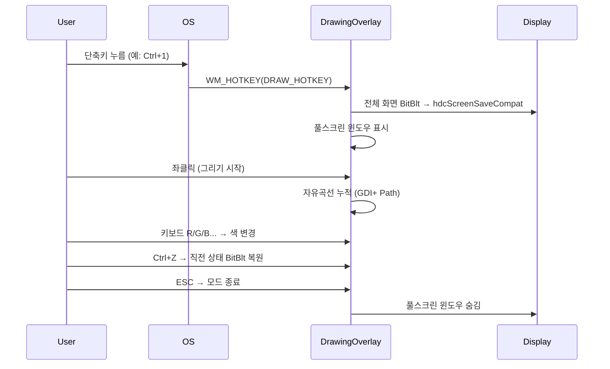
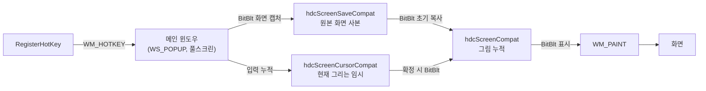

# 사양 03 — 화면 주석 그리기 (Draw)

> 이 문서 하나만으로 화면 주석 그리기 모드를 처음부터 구현할 수 있도록 작성되었습니다. 구현 언어는 Rust를 1순위로 전제하며, Win32/GDI/GDI+ API는 `windows` 또는 `windows-sys` 크레이트로 직접 호출합니다.

---

## 1. 목표 및 범위

데스크톱 어디서나 단축키 한 번으로 **현재 화면을 정지**시키고, 그 위에 자유 곡선·도형·하이라이트·블러를 그릴 수 있는 도구를 만든다.

본 사양은 다음 두 가지 영역을 다룬다.

- **Static Draw**: 화면을 한 장 캡처해서 정지 이미지 위에 주석.
- **공용 그리기 도구**: 자유 곡선, 사각형, 타원, 직선, 화살표, 하이라이트, 블러, 실행 취소, 색·두께 변경.

본 사양은 단축키 등록·녹화·캡쳐 저장 같은 인접 기능은 다루지 않는다(별도 사양 04/05 참조).

## 2. 기술 스택 / 권장 언어

- **1순위 권장**: Rust 2021 이상 + `windows` 또는 `windows-sys` 크레이트로 Win32 API 직접 호출.
- 참고 구현 스택: C++17 이상 Win32 API 직접 호출. 문서의 C++ 의사 코드는 API 호출 순서와 상태 구조를 설명하기 위한 참고용이다.
- 그리기: **GDI+** (자유 곡선·앤티앨리어싱) + **GDI** (`R2_NOT` 러버밴드 도형).
- 색상/도형 데이터는 32-bit RGBA로 다루며 상위 1바이트(알파)에 하이라이트 강도를 인코딩.

## 3. 사용자 흐름



## 4. 기능 요구사항

- [ ] 글로벌 핫키 등록(`RegisterHotKey`) — Draw 키.
- [ ] Draw 키: 즉시 화면 캡처 + 그리기 시작.
- [ ] 좌클릭 드래그 → 자유 곡선.
- [ ] Ctrl+드래그 → 직선 / Shift+드래그 → 사각형 / Tab+드래그 → 타원 / Ctrl+Shift+드래그 → 화살표.
- [ ] 색 단축키: R, G, B, Y, O, P, W, K + Shift 동시 누름 = 하이라이트 변형 + X = 블러.
- [ ] 펜 두께 단축키 (예: Ctrl+휠로 가감), 기본 5, 최소 2, 최대 40.
- [ ] Ctrl+Z 실행 취소 (히스토리 32단계).
- [ ] ESC 종료, 내부 상태/언두 히스토리 초기화.
- [ ] 멀티 모니터: 마우스가 있는 모니터에 대해서만 풀스크린 캡처/렌더.
- [ ] 고DPI: `MonitorFromWindow` + `MONITORINFO` + 시스템 DPI 인식.

## 5. 비기능 요구사항

- **렌더링 60fps 유지**: `WM_PAINT`는 미리 합성해 둔 단일 비트맵을 `BitBlt`만 한 번 호출.
- **메모리**: 언두 스택은 최대 32 프레임, 각 프레임은 모니터 해상도 비트맵 1장. 8K 환경에서도 ~2GB 이하로 제한 (실측 후 한계 강제).
- **입력 지연**: 마우스 다운 후 첫 픽셀이 그려질 때까지 16ms 이내.
- **누수 금지**: 모드 종료 시 모든 GDI 객체(`HBITMAP`, `HDC`, `HRGN`, `HPEN`)와 GDI+ 객체 해제.

## 6. 아키텍처 / 데이터 흐름



핵심: **화면을 직접 그리지 않는다.** 항상 오프스크린 비트맵에 누적한 후 `BitBlt`로 표시.

## 7. 핵심 API / 의존성 표

| 영역 | API |
|---|---|
| 윈도우 | `RegisterClassExW`, `CreateWindowExW(WS_POPUP)`, `ShowWindow`, `SetWindowPos` |
| 캡처(정적) | `GetDC(NULL)` 또는 `CreateDCW(L"DISPLAY")`, `CreateCompatibleDC`, `CreateCompatibleBitmap`, `BitBlt(SRCCOPY|CAPTUREBLT)` |
| 그리기 | GDI: `CreatePen`, `SelectObject`, `MoveToEx`, `LineTo`, `Rectangle`, `Ellipse`, `Polygon`, `SetROP2(R2_NOT)` |
| 그리기(부드러운) | GDI+: `Gdiplus::Graphics`, `Gdiplus::Pen`, `Gdiplus::GraphicsPath`, `Gdiplus::SolidBrush`, `SmoothingModeAntiAlias` |
| 입력 | `RegisterHotKey`, `GetAsyncKeyState`, `WM_HOTKEY`, `WM_LBUTTONDOWN/MOVE/UP`, `WM_KEYDOWN`, `WM_MOUSEWHEEL` |
| 모니터 | `MonitorFromPoint`, `MonitorFromWindow`, `GetMonitorInfoW`, `MONITORINFO` |

## 8. 핵심 클래스/함수 시그니처 (의사 코드)

```cpp
// 펜 색상은 32bit RGBA. 상위 1바이트가 0xFF가 아니면 하이라이트.
inline bool IsHighlight(COLORREF c)  { return (c >> 24) != 0xFF; }
inline bool IsBlur(COLORREF c)       { return (c & 0x00FFFFFF) == RGB(112,112,112); }

enum class Tool { Free, Rectangle, Ellipse, Line, Arrow };

struct DrawingOptions {
    int      penWidth        = 5;     // 기본
    int      minPenWidth     = 2;
    int      maxPenWidth     = 40;
    COLORREF penColor        = 0xFF0000FF; // BGRA, 0xFF=불투명
    Tool     tool            = Tool::Free;
};

class DrawingOverlay {
public:
    bool Start();
    void Stop();
    void HandleHotkey(int id, UINT modifiers, UINT vk);
    void OnMouseDown(POINT p);
    void OnMouseMove(POINT p);
    void OnMouseUp(POINT p);
    void OnKeyDown(UINT vk, UINT modifiers); // 색/도구 단축키
    void Undo();
    void SetTool(Tool t);
    void SetColor(COLORREF c);
    void SetPenWidth(int w);
private:
    HWND          m_hwnd       = nullptr;
    HDC           m_hdcSave    = nullptr;   // 원본 화면 사본
    HDC           m_hdcDraw    = nullptr;   // 그림 누적
    HDC           m_hdcCur     = nullptr;   // 현재 도형 임시
    HBITMAP       m_bmpSave    = nullptr;
    HBITMAP       m_bmpDraw    = nullptr;
    HBITMAP       m_bmpCur     = nullptr;
    POINT         m_cursor{};
    bool          m_drawing    = false;
    DrawingOptions m_opts{};
    std::deque<HBITMAP> m_undoStack; // 최대 32 (MAX_UNDO_HISTORY)
};
```

```cpp
// 프레임 합성 (정적 모드)
LRESULT DrawingOverlay::OnPaint(HDC hdc, RECT clientRc) {
    BitBlt(hdc, 0, 0, clientRc.right, clientRc.bottom,
           m_hdcDraw, 0, 0, SRCCOPY);
    return 0;
}
```

```cpp
// 자유 곡선
void DrawingOverlay::OnMouseMove(POINT p) {
    if (!m_drawing || m_opts.tool != Tool::Free) return;
    Gdiplus::Graphics g(m_hdcDraw);
    g.SetSmoothingMode(Gdiplus::SmoothingModeAntiAlias);

    Gdiplus::Color c(GetAValue(m_opts.penColor),
                     GetBValue(m_opts.penColor),
                     GetGValue(m_opts.penColor),
                     GetRValue(m_opts.penColor));
    Gdiplus::Pen pen(c, static_cast<Gdiplus::REAL>(EffectivePenWidth()));
    g.DrawLine(&pen, m_lastPt.X, m_lastPt.Y, p.x, p.y);
    m_lastPt = { p.x, p.y };

    InvalidateRect(m_hwnd, nullptr, FALSE);
}
```

```cpp
// 실행 취소
void DrawingOverlay::Undo() {
    if (m_undoStack.empty()) return;
    HBITMAP prev = m_undoStack.back(); m_undoStack.pop_back();
    HDC mem = CreateCompatibleDC(nullptr);
    HGDIOBJ old = SelectObject(mem, prev);
    BitBlt(m_hdcDraw, 0,0, m_screenW, m_screenH, mem, 0,0, SRCCOPY);
    SelectObject(mem, old);
    DeleteDC(mem);
    DeleteObject(prev);
    InvalidateRect(m_hwnd, nullptr, FALSE);
}
```

## 9. UI 레이아웃 / 입력 매핑

### 9.1 단축키 표 (기본값)

| 키 / 조합 | 동작 |
|---|---|
| `Ctrl+2` (Draw) | 화면 캡처 + 그리기 진입 |
| 좌클릭 드래그 | 자유 곡선 |
| Shift + 드래그 | 사각형 |
| Tab + 드래그 | 타원 |
| Ctrl + 드래그 | 직선 |
| Ctrl+Shift + 드래그 | 화살표 |
| `R/G/B/Y/O/P/W/K` | 색 변경 (Red/Green/Blue/Yellow/Orange/Pink/White/blacK) |
| Shift + 색키 | 하이라이트 변형 |
| `X` | 블러 모드 |
| `Ctrl+휠` 또는 `[`/`]` | 펜 두께 가감 |
| `Ctrl+Z` | 실행 취소 |
| `ESC` | 종료 |

### 9.2 색 인코딩 규칙

색상은 32-bit `0xAARRGGBB` 로 다루며 다음 규칙을 따른다.

```
- 알파 0xFF                 → 일반 펜
- 알파 < 0xFF               → 하이라이트 (반투명, GDI+ AlphaBlend)
- RGB(112,112,112) 센티넬   → 블러 도구 (실제 픽셀 색이 아니라 "블러를 그려라" 신호)
```

블러는 펜이 지나간 영역에 가우시안 블러를 적용해 누적 비트맵에 다시 쓴다. 가우시안 적용은 GDI+의 `BitmapData` 또는 SIMD 직접 구현 중 선택.

## 10. 입출력 계약

### 10.1 외부 설정과의 결합

설정창(사양 02)에서 다음 값들을 JSON으로 받아 모듈 시작 시 로드한다.

```jsonc
{
  "DrawToggleKey":   { "modifiers": ["Ctrl"], "key": "2" },
  "PenWidth":        5,
  "DefaultPenColor": "#FF0000"
}
```

`{"action":{"Draw":{"action_name":"refresh_settings"}}}` IPC 수신 시 위 JSON을 다시 읽어 적용한다(이미 그리기 모드에 들어가 있다면 다음 진입 시점부터 반영).

### 10.2 모드 전환 메시지

내부 사용자 메시지(권장 `WM_USER + N`):

| 메시지 | 의미 |
|---|---|
| `WM_USER_EXIT_MODE` | 어떤 모드든 즉시 종료 |
| `WM_USER_RELOAD_SETTINGS` | 설정 재로딩 |
| `WM_USER_SAVE_CURSOR` / `RESTORE_CURSOR` | 그리기 중 커서 백업/복원 |

## 11. 엣지 케이스

1. **여러 모니터의 DPI가 다름**: 각 모니터마다 별도 윈도우가 아니라, 마우스가 있는 모니터에 대해서만 풀스크린 윈도우를 띄우고 그 모니터 DPI 기준으로 좌표 환산.
2. **풀스크린 게임/보호 컨텐츠**: GDI 캡처가 검은 화면이 될 수 있음 → 대안으로 `Windows.Graphics.Capture`(사양 04 참조)로 폴백 가능.
3. **언두 메모리 폭증**: 8K 모니터에서 32프레임 = 16GB. 압축(예: 차이 비트맵만 저장)이나 동적 한계가 필요하면 사용자 옵션으로 노출.
4. **고DPI에서 펜 두께가 너무 가늘게 보임**: `EffectivePenWidth()`에서 시스템 DPI를 곱해 실제 픽셀 두께 보정.
5. **하이라이트가 어두운 배경에서 안 보임**: 하이라이트는 항상 가산 합성(`Gdiplus::ColorMatrix`) 또는 `SourceCopy`+알파 블렌딩으로 명도를 보존.
6. **드래그 도중 핫키가 다시 눌림**: 그리기 중에는 추가 핫키 무시 또는 명시적 토글로만 종료.

## 12. 검증 체크리스트

- [ ] 단축키로 정확히 1초 이내에 그리기 모드 진입.
- [ ] 자유 곡선이 부드럽게(앤티앨리어싱) 그려짐.
- [ ] 도형 모드 4종(직선/사각형/타원/화살표)이 모두 러버밴드 미리보기 → 마우스 업에서 확정.
- [ ] 색 8종 + 하이라이트 8종 + 블러가 키보드 단축키로 즉시 전환.
- [ ] Ctrl+Z를 32회까지 누르면 모든 그림이 사라지고 33회째는 무시.
- [ ] ESC 이후 GDI 핸들 누수 없음(VMMap 또는 GDI 카운터로 확인).
- [ ] 멀티 모니터에서 마우스가 있는 모니터에서만 동작.

## 13. 이 문서를 LLM에 그대로 던질 때 추가로 첨부하면 좋은 정보

- 설정 저장 위치(JSON 경로) 또는 레지스트리 경로.
- 원하는 핫키 기본값 (위의 권장값을 그대로 쓸지 또는 다른 조합).
- 8K/HDR 모니터 지원 여부 (지원해야 하면 `Windows.Graphics.Capture` 폴백 사양 04 참조).

---

## 부록 A — `WM_USER_*` 사용자 메시지 권장 ID

```cpp
constexpr UINT WM_USER_TYPING_OFF        = WM_USER + 101;
constexpr UINT WM_USER_GET_SOURCE_RECT   = WM_USER + 103;
constexpr UINT WM_USER_STOP_RECORDING    = WM_USER + 105; // 사양 04에서 사용
constexpr UINT WM_USER_SAVE_CURSOR       = WM_USER + 106;
constexpr UINT WM_USER_RESTORE_CURSOR    = WM_USER + 107;
constexpr UINT WM_USER_MAGNIFY_CURSOR    = WM_USER + 108;
constexpr UINT WM_USER_EXIT_MODE         = WM_USER + 109;
constexpr UINT WM_USER_RELOAD_SETTINGS   = WM_USER + 110;
constexpr UINT WM_USER_RECORDING_STARTED = WM_USER + 111;
```

## 부록 B — 색 상수 권장 값

```cpp
constexpr COLORREF COLOR_RED    = RGB(255,   0,   0);
constexpr COLORREF COLOR_GREEN  = RGB(  0, 255,   0);
constexpr COLORREF COLOR_BLUE   = RGB(  0,   0, 255);
constexpr COLORREF COLOR_ORANGE = RGB(255, 128,   0);
constexpr COLORREF COLOR_YELLOW = RGB(255, 255,   0);
constexpr COLORREF COLOR_PINK   = RGB(255, 128, 255);
constexpr COLORREF COLOR_WHITE  = RGB(255, 255, 255);
constexpr COLORREF COLOR_BLACK  = RGB(  0,   0,   0);
constexpr COLORREF COLOR_BLUR   = RGB(112, 112, 112); // 센티넬
```

## 부록 C — 한계값 요약

| 이름 | 값 |
|---|---|
| `PEN_WIDTH` (기본) | 5 |
| `MIN_PEN_WIDTH` | 2 |
| `MAX_PEN_WIDTH` | 40 |
| `MAX_UNDO_HISTORY` | 32 |
