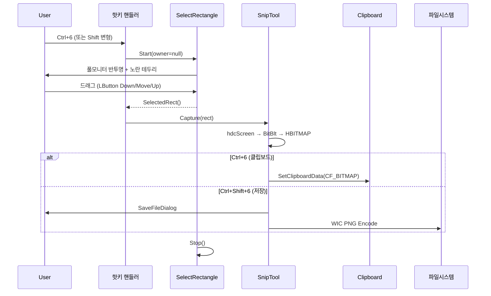
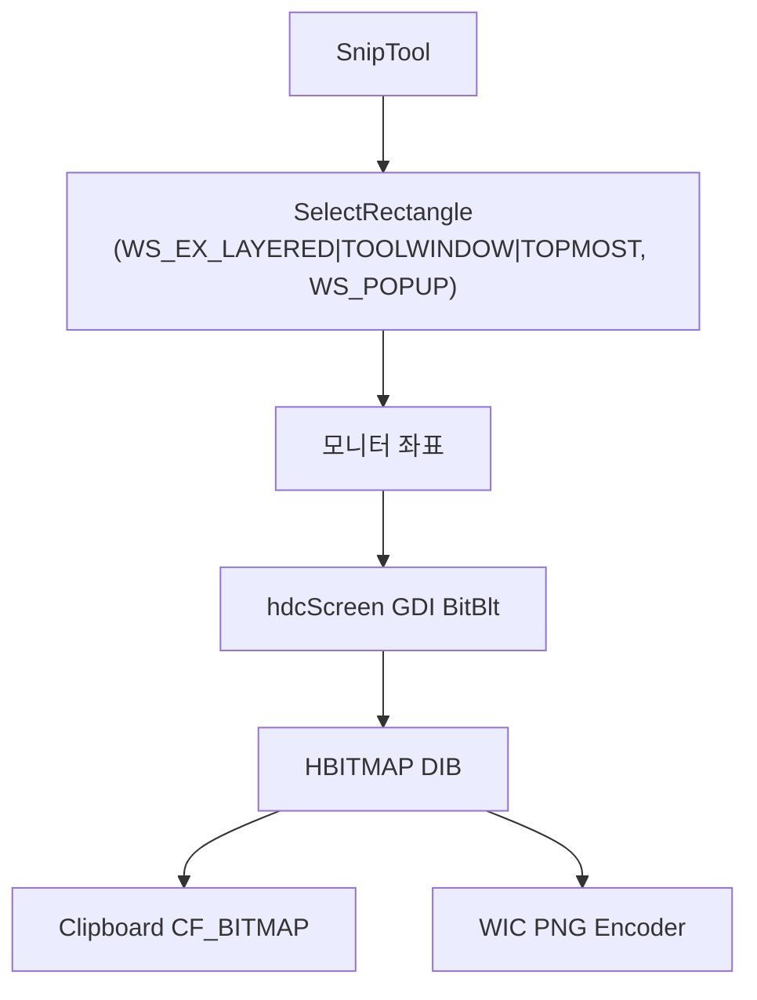

# 사양 05 — 영역 스크린샷 (Snip) + 재사용 가능한 SelectRectangle

> 이 문서 하나만으로 ZoomIt의 Snip 동작과 재사용 가능한 영역 선택 컴포넌트(`SelectRectangle`)를 처음부터 구현할 수 있도록 작성되었습니다. 구현 언어는 Rust를 1순위로 전제하며, Win32/GDI/WIC API는 `windows` 또는 `windows-sys` 크레이트로 직접 호출합니다.

---

## 1. 목표 및 범위

화면 위에서 사용자가 드래그로 사각형 영역을 선택하면, 해당 영역을 캡처하여 다음 둘 중 하나로 출력한다.

1. **클립보드에 비트맵으로 복사** (단축키: 기본 `Ctrl+6`)
2. **PNG 파일로 저장** (단축키: 기본 `Ctrl+Shift+6`)

본 사양은 두 가지 컴포넌트로 구성된다.

- **`SnipTool`** — 위 흐름을 오케스트레이션하는 상위 모듈.
- **`SelectRectangle`** — 영역 드래그 UI를 제공하는 재사용 가능한 클래스. 사양 04(녹화)에서도 사용된다.

`SelectRectangle`을 다른 모듈(녹화)에서도 깔끔하게 재사용할 수 있도록 공개 API를 매우 명확히 정의한다.

## 2. 기술 스택 / 권장 언어

- **1순위 권장**: Rust 2021 이상 + `windows` 또는 `windows-sys` 크레이트로 Win32 API 직접 호출.
- 참고 구현 스택: C++17 이상 Win32 API 직접 호출. 문서의 C++ 의사 코드는 API 호출 순서와 상태 구조를 설명하기 위한 참고용이다.
- 캡처: GDI (`BitBlt`/`StretchBlt`) — 모니터 단위에서 충분히 빠르고 의존이 가볍다.
- 저장: WIC (`GUID_ContainerFormatPng`).
- 보조 라이브러리: WIL (`wil::unique_hwnd` 등) — 선택 사항이지만 권장.

DRM/HDR 캡처가 필요한 경우 사양 04의 Windows.Graphics.Capture로 폴백할 수 있도록 설계.

## 3. 사용자 흐름



## 4. 기능 요구사항

### 4.1 SnipTool

- [ ] 두 개의 핫키: 클립보드 복사 / 파일 저장.
- [ ] 호출 시 마우스가 있는 모니터에 대해 풀스크린 영역 선택 창을 띄운다.
- [ ] 사용자가 드래그 후 마우스를 떼면 즉시 캡처를 수행하고 선택 창은 닫는다(녹화와 다름).
- [ ] 캡처는 모니터 절대 좌표 기준의 GDI BitBlt + DIB 비트맵.
- [ ] 클립보드 모드: `CF_BITMAP` 으로 복사 후 사용자에게 토스트(선택).
- [ ] 저장 모드: `IFileSaveDialog` 로 PNG 저장 (`*.png`, 기본 이름 `snip-<timestamp>.png`).
- [ ] 마우스가 캡처 권한이 없는 영역(예: UAC 보호) 위에 있으면 검은 픽셀이 들어올 수 있음 → 사용자에게 알림.

### 4.2 SelectRectangle (공용 컴포넌트)

- [ ] 풀모니터(또는 owner 영역) 위에 떠 있는 레이어드 윈도우.
- [ ] 선택 전: 전체에 반투명 알파 적용 + 얇은 노란 테두리.
- [ ] 드래그 시: 선택 영역만 알파 0(투명) → "구멍이 뚫린" 듯 보임. 외곽은 그대로 반투명.
- [ ] 마우스 업: 선택 확정 → `SelectedRect()` 가 채워짐.
- [ ] 옵션: 알파(0~255), 최소 크기(픽셀), 종횡비 강제(`AspectRatio(double)`, 0=무제약).
- [ ] 녹화처럼 "선택 후에도 살아 있어야 하는" 모드를 위해 `SetRecordingActive()` 호출 시 빨간 두꺼운 테두리로 변경.
- [ ] 자기 자신을 캡처/녹화에서 배제할 수 있는 `SetExcludeFromCapture(true)` (`SetWindowDisplayAffinity(WDA_EXCLUDEFROMCAPTURE)`).
- [ ] DPI 인식 — 모니터 DPI 캐시.
- [ ] 키보드 ESC = 취소 → `IsSelected()`는 false, `Start()`도 false 반환(또는 별도 `IsCancelled()`).

## 5. 비기능 요구사항

- **부팅 지연**: `Start()` 호출 후 첫 페인팅까지 50ms 이내.
- **DPI 안전**: 200% 스케일 모니터에서도 테두리 두께가 시각적으로 동일.
- **취소 안전**: 사용자가 ESC로 취소해도 호출 측에서 폴링 없이 명확히 결과를 받을 수 있어야 함.
- **다중 모니터**: 마우스가 있는 모니터의 사각형 좌표만 클램프해 반환.

## 6. 아키텍처 / 데이터 흐름



## 7. 핵심 API / 의존성 표

| 영역 | API |
|---|---|
| 윈도우 | `CreateWindowExW(WS_EX_LAYERED|WS_EX_TOOLWINDOW|WS_EX_TOPMOST, ..., WS_POPUP)` |
| 알파 | `SetLayeredWindowAttributes(hwnd, 0, alpha, LWA_ALPHA)` |
| 클릭 통과 | `WS_EX_TRANSPARENT` + `EnableWindow(FALSE)` |
| 자기 캡처 배제 | `SetWindowDisplayAffinity(WDA_EXCLUDEFROMCAPTURE)` |
| 영역 리전 | `CreateRectRgn`, `CreateRoundRectRgn`, `CombineRgn(RGN_DIFF/XOR)`, `SetWindowRgn` |
| 입력 | `WM_LBUTTONDOWN/MOVE/UP`, `WM_KEYDOWN`(ESC), `WM_PAINT` |
| 커서 가둠 | `ClipCursor(LPRECT)` / `ClipCursor(NULL)` 복원 |
| 모니터 | `MonitorFromPoint`, `GetMonitorInfoW` |
| 캡처 | `CreateDC(L"DISPLAY", ...)` 또는 `GetDC(NULL)`, `CreateCompatibleDC`, `CreateCompatibleBitmap`, `BitBlt`/`StretchBlt(SRCCOPY|CAPTUREBLT)` |
| 클립보드 | `OpenClipboard`, `EmptyClipboard`, `SetClipboardData(CF_BITMAP, hbm)`, `CloseClipboard` |
| PNG 저장 | WIC: `IWICImagingFactory::CreateEncoder(GUID_ContainerFormatPng)`, `IWICStream::InitializeFromFilename` |
| 파일 다이얼로그 | `IFileSaveDialog` (`CLSID_FileSaveDialog`), `IShellItem`, `SetFileTypes`, `Show`, `GetResult` |
| DPI | `GetDpiForWindow`, `SystemParametersInfoForDpi` |

## 8. 핵심 클래스/함수 시그니처

### 8.1 SelectRectangle

```cpp
class SelectRectangle {
public:
    SelectRectangle();
    ~SelectRectangle();

    // 옵션 (Start 호출 전에 설정)
    void   Alpha(BYTE a);              BYTE   Alpha() const;        // 기본 176
    void   MinSize(int px);            int    MinSize() const;      // 기본 34
    void   AspectRatio(double r);      double AspectRatio() const;  // 0 = 무제약, 예: 16.0/9.0

    // 라이프사이클
    bool   Start(HWND ownerWindow = nullptr, bool fullMonitor = false);
    void   Stop();
    void   UpdateOwner(HWND window);
    bool   IsActive() const;
    bool   IsSelected() const;
    RECT   SelectedRect() const;

    // 가시성/상태
    void   Hide();                     // ShowWindow SW_HIDE
    void   Show();                     // ShowWindow SW_SHOWNA
    void   SetRecordingActive();       // 녹화 진입 시 빨간 두꺼운 테두리
    void   SetExcludeFromCapture(bool exclude);

private:
    static LRESULT CALLBACK StaticWndProc(HWND, UINT, WPARAM, LPARAM);
    LRESULT WindowProc(HWND, UINT, WPARAM, LPARAM);
    void    ShowSelected();   // 확정 후 클릭 통과 + 테두리만 표시 모드

    BYTE       m_alpha = 176;
    int        m_minSize = 34;
    double     m_aspectRatio = 0.0;
    COLORREF   m_borderColor = RGB(255, 222, 0); // 노랑 (캡처 API 기본 테두리와 같은 톤)
    bool       m_recordingActive = false;
    bool       m_fullMonitor = false;
    bool       m_cancel = false;
    bool       m_selected = false;
    bool       m_setClip = false;
    bool       m_stopping = false;
    UINT       m_dpi = 96;
    RECT       m_oldClipRect{};
    POINT      m_startPoint{};
    RECT       m_selectedRect{};
    const wchar_t* m_className = L"YourAppSelectRectangle";
    wil::unique_hwnd m_window;
};
```

### 8.2 SnipTool

```cpp
class SnipTool {
public:
    enum class Output { Clipboard, FileDialog };

    bool RunOnce(Output mode); // 한 번 실행: 사용자가 영역 선택 → 캡처/저장
};
```

내부 흐름:

```cpp
bool SnipTool::RunOnce(Output mode) {
    SelectRectangle sel;
    sel.Alpha(176);
    sel.MinSize(8);
    if (!sel.Start()) return false; // ESC 취소

    RECT rc = sel.SelectedRect();
    sel.Stop();

    HWND root = GetDesktopWindow();
    HDC  src  = GetDC(root);
    HDC  dst  = CreateCompatibleDC(src);
    int  w = rc.right - rc.left;
    int  h = rc.bottom - rc.top;
    HBITMAP bmp = CreateCompatibleBitmap(src, w, h);
    HGDIOBJ old = SelectObject(dst, bmp);
    BitBlt(dst, 0, 0, w, h, src, rc.left, rc.top, SRCCOPY | CAPTUREBLT);
    SelectObject(dst, old);
    DeleteDC(dst);
    ReleaseDC(root, src);

    if (mode == Output::Clipboard) {
        CopyToClipboard(bmp);   // 아래 §9.1
        DeleteObject(bmp);
    } else {
        SaveToPng(bmp, w, h);   // 아래 §9.2 (Save 다이얼로그 + WIC)
        DeleteObject(bmp);
    }
    return true;
}
```

## 9. 출력 구현

### 9.1 클립보드 복사

`CF_BITMAP` 은 클립보드가 비트맵 핸들의 소유권을 갖는다. 호출 측은 `SetClipboardData` 이후 자체 핸들을 사용/해제하면 안 된다 → 미리 사본을 만들어 둔다.

```cpp
HBITMAP CopyBitmap(HBITMAP src) {
    BITMAP info{}; GetObjectW(src, sizeof(info), &info);
    HDC mem = CreateCompatibleDC(nullptr);
    HDC mem2 = CreateCompatibleDC(nullptr);
    HBITMAP dst = CreateCompatibleBitmap(GetDC(nullptr), info.bmWidth, info.bmHeight);
    HGDIOBJ o1 = SelectObject(mem,  src);
    HGDIOBJ o2 = SelectObject(mem2, dst);
    BitBlt(mem2, 0,0, info.bmWidth, info.bmHeight, mem, 0,0, SRCCOPY);
    SelectObject(mem,  o1); SelectObject(mem2, o2);
    DeleteDC(mem); DeleteDC(mem2);
    return dst;
}

bool CopyToClipboard(HBITMAP src) {
    if (!OpenClipboard(nullptr)) return false;
    EmptyClipboard();
    HBITMAP toGive = CopyBitmap(src);
    SetClipboardData(CF_BITMAP, toGive); // 이후 toGive는 클립보드 소유
    CloseClipboard();
    return true;
}
```

### 9.2 PNG 저장 (WIC)

```cpp
HRESULT SaveBmpToPng(HBITMAP bmp, UINT w, UINT h, const std::wstring& path) {
    winrt::com_ptr<IWICImagingFactory> factory;
    RETURN_IF_FAILED(CoCreateInstance(CLSID_WICImagingFactory, nullptr, CLSCTX_INPROC_SERVER,
                                       IID_PPV_ARGS(factory.put())));

    winrt::com_ptr<IWICBitmap> source;
    RETURN_IF_FAILED(factory->CreateBitmapFromHBITMAP(bmp, nullptr, WICBitmapIgnoreAlpha, source.put()));

    winrt::com_ptr<IWICStream> stream;
    RETURN_IF_FAILED(factory->CreateStream(stream.put()));
    RETURN_IF_FAILED(stream->InitializeFromFilename(path.c_str(), GENERIC_WRITE));

    winrt::com_ptr<IWICBitmapEncoder> encoder;
    RETURN_IF_FAILED(factory->CreateEncoder(GUID_ContainerFormatPng, nullptr, encoder.put()));
    RETURN_IF_FAILED(encoder->Initialize(stream.get(), WICBitmapEncoderNoCache));

    winrt::com_ptr<IWICBitmapFrameEncode> frame;
    winrt::com_ptr<IPropertyBag2>         bag;
    RETURN_IF_FAILED(encoder->CreateNewFrame(frame.put(), bag.put()));
    RETURN_IF_FAILED(frame->Initialize(bag.get()));
    RETURN_IF_FAILED(frame->SetSize(w, h));
    auto pf = GUID_WICPixelFormat32bppBGRA;
    RETURN_IF_FAILED(frame->SetPixelFormat(&pf));
    RETURN_IF_FAILED(frame->WriteSource(source.get(), nullptr));
    RETURN_IF_FAILED(frame->Commit());
    RETURN_IF_FAILED(encoder->Commit());
    return S_OK;
}
```

`IFileSaveDialog`는 표준 사용법(생략).

## 10. SelectRectangle 내부 구현 핵심

### 10.1 윈도우 생성

```cpp
DWORD ex = WS_EX_LAYERED | WS_EX_TOOLWINDOW | WS_EX_TOPMOST;
HWND h = CreateWindowExW(ex, m_className, nullptr, WS_POPUP,
                         monRc.left, monRc.top,
                         monRc.right - monRc.left, monRc.bottom - monRc.top,
                         ownerWindow, nullptr, GetModuleHandleW(nullptr), this);
SetLayeredWindowAttributes(h, 0, m_alpha, LWA_ALPHA);

// 자기 자신을 보호하려면
SetWindowDisplayAffinity(h, WDA_EXCLUDEFROMCAPTURE);

// 마우스 가둠 (선택 사항)
GetClipCursor(&m_oldClipRect);
m_setClip = true;
ClipCursor(&monRc);

ShowWindow(h, SW_SHOWNA);
```

### 10.2 드래그 처리

```cpp
case WM_LBUTTONDOWN:
    m_startPoint = { GET_X_LPARAM(lParam), GET_Y_LPARAM(lParam) };
    m_selectedRect = { m_startPoint.x, m_startPoint.y, m_startPoint.x, m_startPoint.y };
    SetCapture(window);
    return 0;

case WM_MOUSEMOVE:
    if (!(wParam & MK_LBUTTON)) return 0;
    UpdateRect({ GET_X_LPARAM(lParam), GET_Y_LPARAM(lParam) });
    InvalidateRect(window, nullptr, FALSE);
    return 0;

case WM_LBUTTONUP:
    ReleaseCapture();
    NormalizeRect(m_selectedRect);
    if (RectWidth(m_selectedRect) < m_minSize ||
        RectHeight(m_selectedRect) < m_minSize) {
        m_cancel = true;
    } else {
        m_selected = true;
    }
    PostMessageW(window, WM_USER, 0, 0); // 메시지 루프 종료 신호
    return 0;
```

### 10.3 페인팅 — 외곽은 알파, 선택 영역은 투명 + 테두리

선택 영역만 클라이언트에서 비우고 싶을 때 사용하는 두 가지 기법.

**기법 A — 윈도우 리전 (선택 영역에 "구멍")**

```cpp
HRGN whole = CreateRectRgn(0, 0, cw, ch);
HRGN hole  = CreateRectRgn(m_selectedRect.left,  m_selectedRect.top,
                           m_selectedRect.right, m_selectedRect.bottom);
CombineRgn(whole, whole, hole, RGN_DIFF);
SetWindowRgn(window, whole, TRUE);
DeleteObject(hole);
```

**기법 B — `WM_PAINT`에서 알파 채워 그리기**

`UpdateLayeredWindow` 또는 `LWA_ALPHA + LWA_COLORKEY` 조합으로 한 영역만 투명.

두 기법 중 하나로 일관되게 구현. 성능과 가시성에서 기법 A를 권장.

**테두리**: `WM_PAINT`에서 `CreatePen(PS_SOLID, dpiAdjusted(2 또는 4), m_borderColor)` 로 `Rectangle(hdc, ...)`. `SetRecordingActive()` 호출 후에는 두께 ≥4 + 빨간색.

### 10.4 확정 후 표시 모드 (녹화용)

```cpp
void SelectRectangle::ShowSelected() {
    SetWindowLongPtrW(m_window.get(), GWL_EXSTYLE,
        GetWindowLongPtrW(m_window.get(), GWL_EXSTYLE) | WS_EX_TRANSPARENT);
    EnableWindow(m_window.get(), FALSE);
    ClipCursor(nullptr); // 마우스 가둠 해제
}
```

이렇게 하면 사용자는 선택된 영역 안의 다른 앱과 정상적으로 상호작용할 수 있고, 우리 윈도우는 위에 떠서 노란/빨간 테두리만 보여 준다.

## 11. SelectRectangle 공개 API 명세 (재사용 사양)

다른 사양(예: 04 녹화)에서도 동일한 시그니처로 재사용한다.

```cpp
// 헤더 한 장으로 끝나는 API
struct SelectRectangleOptions {
    BYTE     alpha           = 176;
    int      minSize         = 34;
    double   aspectRatio     = 0.0;       // 0 = 무제약
    bool     fullMonitor     = false;     // 풀스크린 vs owner 영역
    bool     excludeFromCapture = true;   // 기본값 권장
    HWND     owner           = nullptr;
};

class ISelectRectangle {
public:
    virtual ~ISelectRectangle() = default;
    virtual bool Start(const SelectRectangleOptions& opts) = 0;
    virtual void Stop() = 0;
    virtual bool IsActive() const = 0;
    virtual bool IsSelected() const = 0;
    virtual RECT SelectedRect() const = 0;
    virtual void Hide() = 0;
    virtual void Show() = 0;
    virtual void SetRecordingActive() = 0;
    virtual void SetExcludeFromCapture(bool exclude) = 0;
};
```

녹화 사양(04)에서는 `Start(opts)` 후 곧바로 `SelectedRect()`를 얻고 `SetRecordingActive()`로 시각 상태만 바꿔 살려 둔다. Snip 사양(05)에서는 `Start()` → `SelectedRect()` → `Stop()` 즉시 닫는다.

## 12. 입출력 계약

### 12.1 핫키 (권장 기본값)

| 핫키 | 동작 |
|---|---|
| `Ctrl+6` | 영역 → 클립보드 |
| `Ctrl+Shift+6` | 영역 → PNG 저장 |

### 12.2 클립보드 포맷

`CF_BITMAP` 만 권장. PNG 저장 모드와 다르게 알파 채널은 보존되지 않을 수 있음(다른 앱 호환을 위해 의도적으로 단순 BGRA만).

### 12.3 PNG 메타데이터

PNG에는 다음 메타를 권장한다(기본값):

- `Software` = "YourApp <version>"
- `tIME` = 캡처 시각 UTC
- 크기, DPI는 모니터 DPI를 그대로 기록.

WIC 메타 작성은 PNG `tEXt`/`pHYs` 청크를 직접 노출하지 않으므로, 필요하면 `IWICMetadataBlockWriter`로 별도 처리.

## 13. 엣지 케이스

1. **ESC 취소**: `m_cancel = true` + `Start()` 가 false 반환. 호출 측은 결과를 절대 사용하지 말 것.
2. **드래그가 1픽셀 미만**: `m_minSize` 미만이면 자동 취소.
3. **DRM/UAC 보호 영역**: `BitBlt`가 검은 픽셀을 반환할 수 있음 → 사용자에게 알림. 필요 시 사양 04의 WGC로 폴백.
4. **다중 모니터 경계**: 시작/끝점이 다른 모니터에 걸쳐 있을 때 **시작점이 있는 모니터로 클램프** 권장.
5. **종횡비 강제 모드**: 최종 사각형 너비/높이가 강제 비율을 만족하지 않으면 짧은 축에 맞춰 잘라낸다.
6. **고DPI**: 테두리 두께를 `MulDiv(thickness, dpi, 96)`로 보정.
7. **클립보드 점유 실패**: 다른 프로세스가 클립보드를 잠궜을 때 `OpenClipboard` 실패 → 100ms 간격으로 5회 재시도 후 사용자에게 알림.
8. **선택 창이 자기 자신을 캡처**: `SetWindowDisplayAffinity(WDA_EXCLUDEFROMCAPTURE)` + (DRM 정책 호환을 위해) 캡처 직전 `Hide()` 후 `BitBlt` → `Show()` 이중 안전장치.

## 14. 검증 체크리스트

- [ ] 핫키 → 영역 선택 → 마우스 업 즉시 결과 출력까지 전체 사이클이 1초 이내.
- [ ] ESC로 취소 시 부수효과(클립보드 변경, 파일 생성) 없음.
- [ ] 선택 영역이 정확한 모니터 절대 좌표로 캡처됨(off-by-one 없음).
- [ ] 멀티 모니터에서 200% DPI 스케일 모니터에서도 테두리 두께가 적절.
- [ ] 클립보드 모드: Paint, Word 등 일반 앱에 붙여넣기 가능.
- [ ] PNG 모드: 픽셀 동등성(원본과 픽셀 단위로 동일), 메타데이터 누락 없음.
- [ ] `SelectRectangle`이 `Hide()`/`Show()` 토글로 자기 자신을 캡처에서 안정적으로 빠져 나감(녹화 사양 04에서 검증).
- [ ] 동일 클래스를 사양 04에서 시각 상태만 바꾸어 재사용 가능.

## 15. 이 문서를 LLM에 그대로 던질 때 추가로 첨부하면 좋은 정보

- 윈도우 클래스명 컨벤션 (예: `YourAppSelectRectangle`).
- 토스트/알림 인프라가 이미 있다면 그 호출 방법.
- DRM/UAC 영역 캡처 정책 (실패 허용 vs 폴백 강제).
- 기본 PNG 저장 위치 (예: `%USERPROFILE%\Pictures\YourApp\`).
- 클립보드 외 다른 출력(예: 자동 OCR, 즉시 공유)이 필요한지.

---

## 부록 A — `WM_PAINT` 한 줄 요약

```cpp
case WM_PAINT: {
    PAINTSTRUCT ps;
    HDC hdc = BeginPaint(window, &ps);
    HBRUSH bg = (HBRUSH)GetStockObject(BLACK_BRUSH); // 알파와 결합 시 어둡게
    FillRect(hdc, &ps.rcPaint, bg);
    DrawBorder(hdc, m_selectedRect,
               m_recordingActive ? RGB(255,0,0) : m_borderColor,
               m_recordingActive ? 4 : 2);
    EndPaint(window, &ps);
    return 0;
}
```

`SetWindowRgn`으로 선택 영역에 구멍을 뚫었다면, 그 구멍 영역은 자동으로 화면이 그대로 보이고 우리 페인팅의 영향을 받지 않는다.

## 부록 B — 관련 문서

- 동일 컴포넌트(녹화에서의 사용) → [04-zoomit-record-gif-spec.md](./04-zoomit-record-gif-spec.md)
- 단축키 디스패처/트레이 → [01-tray-icon-spec.md](./01-tray-icon-spec.md)
- 설정 UI → [02-settings-window-spec.md](./02-settings-window-spec.md)
