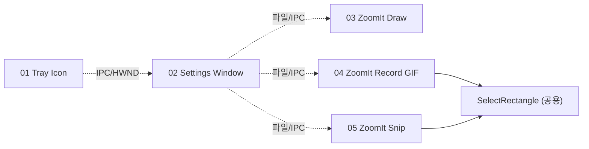

# PowerToys 기능 클론용 사양 문서 모음

이 폴더는 PowerToys의 일부 기능을 **다른 프로젝트/다른 LLM 세션**에서 처음부터 구현하도록 의뢰할 때 그대로 프롬프트로 사용할 수 있는 자족적 사양 문서들을 모아 둡니다.

PowerToys 자체 코드는 변경하지 않으며, 각 문서는 PowerToys의 빌드 시스템·GPO·Telemetry·Sysinternals 분기 같은 내부 의존을 제거한 **표준 Win32/WinRT/WinUI 명세**로 일반화되어 있습니다.

모든 사양의 구현 언어 1순위는 **Rust**입니다. 문서 안의 C++/C#/WinRT 코드는 원본 API 동작과 호출 순서를 설명하기 위한 참고 스택으로 취급합니다.

## 사용 방법

1. 만들고 싶은 기능에 해당하는 단일 마크다운 파일을 엽니다.
2. 파일 내용을 통째로 복사해서 다른 LLM 세션의 첫 메시지에 붙여 넣습니다.
3. 기본 구현 언어는 Rust로 보고, 다른 스택을 원할 때만 마지막에 "이 사양에 따라 \[언어/스택\]로 구현해 주세요." 정도의 한 줄을 덧붙입니다.

각 사양 끝의 **"이 문서를 LLM에 그대로 던질 때 추가로 첨부하면 좋은 정보"** 섹션을 미리 채우면 결과 품질이 크게 올라갑니다(타깃 OS, UI 라이브러리 선택, 패키징 방식 등).

## 문서 목록

| # | 파일 | 다루는 범위 | 참고 스택 | 1순위 구현 언어 |
|---|---|---|---|---|
| 01 | [01-tray-icon-spec.md](./01-tray-icon-spec.md) | Windows 시스템 트레이 아이콘 + 동적 컨텍스트 메뉴 + 단일/더블 클릭 분기 + 외부 종료 채널 | C++ Win32 (또는 C# P/Invoke) | Rust |
| 02 | [02-settings-window-spec.md](./02-settings-window-spec.md) | WinUI 3 기반 설정창 셸(NavigationView+Frame) + CommunityToolkit Settings 카드 + JSON 영속화 + 명명 파이프 IPC | C# / WinUI 3 (Windows App SDK) | Rust |
| 03 | [03-zoomit-draw-spec.md](./03-zoomit-draw-spec.md) | 화면 주석 그리기 + 도형/하이라이트/블러/실행취소 | C++ Win32 + GDI+ | Rust |
| 04 | [04-zoomit-record-gif-spec.md](./04-zoomit-record-gif-spec.md) | Windows.Graphics.Capture + D3D11 캡처 → WIC GIF 인코딩(NETSCAPE2.0 루프) | C++/WinRT | Rust |
| 05 | [05-zoomit-snip-spec.md](./05-zoomit-snip-spec.md) | 영역 드래그 선택 → 모니터 DC 캡처 → 클립보드/PNG 저장 (재사용 가능한 SelectRectangle 컴포넌트 포함) | C++ Win32 + WIC | Rust |

## 의존 관계

`SelectRectangle`은 04와 05가 공유하는 영역 선택 컴포넌트로 두 사양에 모두 동일한 명세가 포함됩니다.

## 작성 원칙

- **본문은 한국어**, 코드 스니펫·API 이름·식별자는 영어 그대로.
- **자족성** — 각 문서 하나만으로 구현이 가능하도록 의존 항목을 본문에 인라인.
- **일반화** — PowerToys 내부 함수/매크로 이름이 보이면, 그 의미만 남기고 표준 API로 풀어 씀.
- **다이어그램** — 핵심 흐름은 mermaid로 표현(공백 없는 노드 ID, 특수문자 라벨은 따옴표로 감쌈).
- **한계값** — 기본/최소/최대 값은 가능한 한 수치로 명시.

## 라이선스/출처

본 사양은 [microsoft/PowerToys](https://github.com/microsoft/PowerToys) (MIT) 코드의 동작을 일반화·기술한 문서입니다. 코드 자체를 복제하지 않았으며, 구현체를 새로 만들 때는 사양만 참고하면 됩니다.
