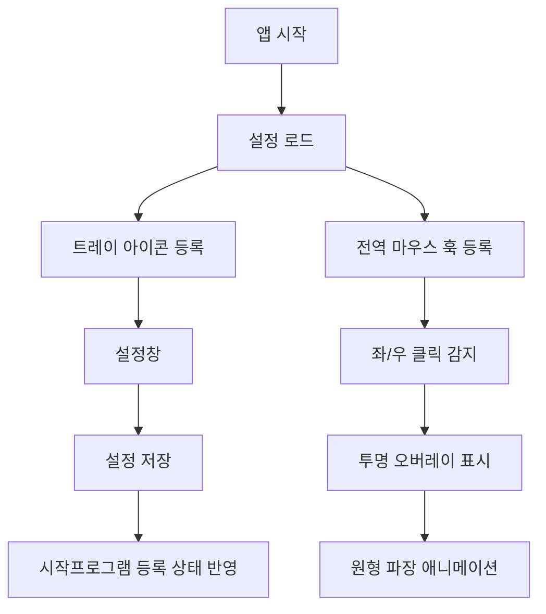
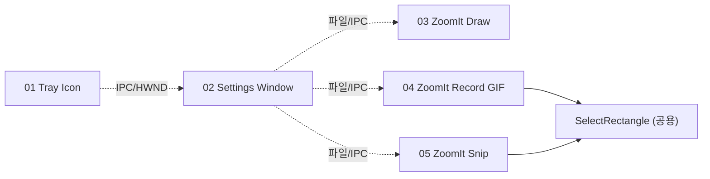

## Simple is best. 자유도를 없애자.
효과반지름 30 - 20
효과속도 52 - 55

## 추가 기능
- 아이콘변경
- 클립보드, snippet, 메일 ひな形 등
- 닉네임 낙인
- 빠른 저장물 선택, 스냅샷이나 gif는 컨텍스트메뉴 우하단 작은 팝업에서 보여주고 드래그해서 넣거나 복사 할수있다.
- 설정창 디자인 미리보기느낌으로 
- 클릭효과 클릭누르고 땔때까지느 흔적을 남길까 토글?
- 출력 파일 명명 규칙과 기본 저장 위치.

## 문제점
- 화면 맨위에 영역을 둘때 틀 이 두꺼워서 그만큼 손해보면서 녹화된다.
- draw 가 거친 느낌이다. 부드럽게 할수있나. TAB누르고 원그릴때 원모양이 이상하다.

## 성능이유
- 그림을 계속 그릴수록 성능이 무거워지는게 보인다. DRAW가 실시간으로 그려지는게 아니라 멈췃다가 한순간에 그려지는 듯한현상이 그림을 그릴수록 좀더 생긴다.
- 지금 컴퓨터 환경말고 다른컴퓨터에서 확인 DPI배율이나 모니터환경에따라서 보정필요?
- 기본 스케일/FPS 정책(메모리 보호 우선 vs 화질 우선).
- CPU/메모리: 4K 30fps GIF는 WIC의 8bpp 디더링이 단일 스레드에서 무거움 → 사양은 "가능하다면 CPU 코어를 활용해 프레임 인코딩을 직렬 큐에 비동기"로 권장. 적어도 1080p 15fps에서는 60초 녹화가 RAM 1GB 이내로 끝나야 함.
- 드롭 정책: 인코더가 못 따라가면 새 프레임을 버리지 말고 직전 프레임을 GIF에 추가(시각적 끊김 < 메모리 폭증).
- 정확한 타이밍: 각 프레임의 GIF Delay 메타데이터는 100분의 1초 단위. 15fps → Delay = 7 (실제 6.66의 반올림).
- 사용자 지정 FPS (기본 15). 정확히 1000/FPS ms 간격 시도, 새 프레임이 없으면 직전 프레임 복제.
- 타깃 OS 최저 버전(Windows 10 1809 / 1903 / 19041 중 어디까지).
- 스레드 안전: 캡처 콜백은 비동기 스레드. 인코더 접근은 mutex로 직렬화.

# Rust 클릭 효과 앱 구현 계획

## 구현 방향
- 경량화를 위해 Tauri 같은 웹뷰 기반 프레임워크는 사용하지 않고, `windows` crate 기반 Win32 네이티브 앱으로 구현합니다.

## 주요 파일
- [`Cargo.toml`](Cargo.toml): Rust 패키지와 `windows`, `serde`, 설정 저장용 의존성 정의
- [`src/main.rs`](src/main.rs): Win32 메시지 루프, 트레이 아이콘, 전역 마우스 훅, 오버레이 윈도우 진입점
- [`src/config.rs`](src/config.rs): 좌/우 클릭 색상, 시작프로그램 여부를 JSON 설정 파일로 저장/로드
- [`src/startup.rs`](src/startup.rs): 현재 실행 파일을 Windows 시작프로그램 레지스트리에 등록/해제
- [`src/tray.rs`](src/tray.rs): 작업표시줄 트레이 아이콘, 설정/종료 메뉴 처리
- [`src/effect.rs`](src/effect.rs): 클릭 위치 주변 원형 파장 애니메이션 렌더링

## 동작 구조

## 의존 관계

