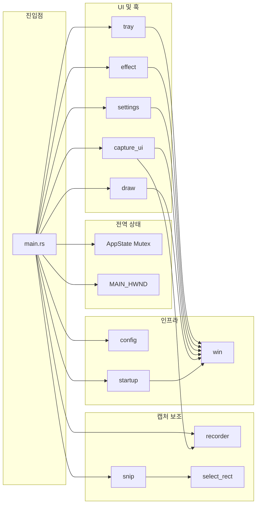
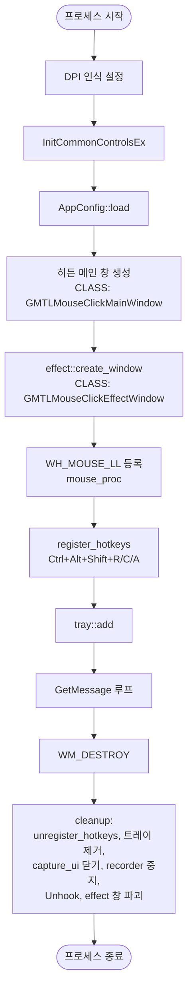
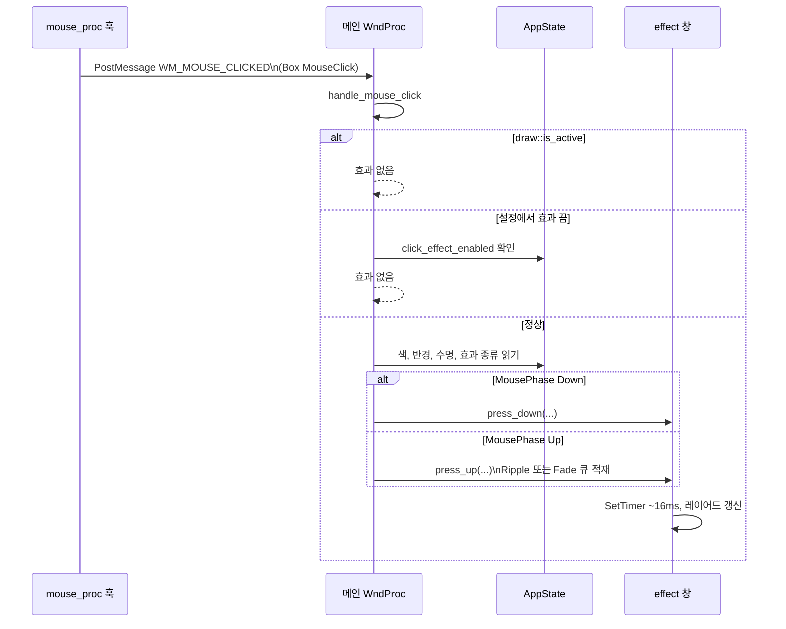
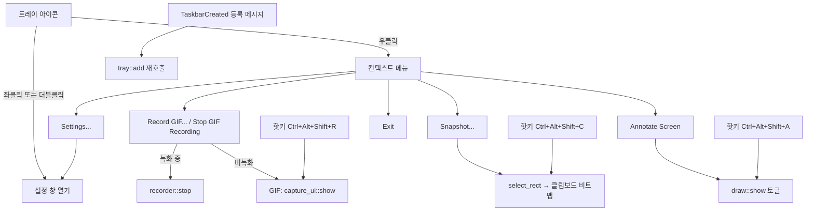

# Architecture and feature specification

> **Codebase**: Rust + `windows-sys` Win32 app. Package `ccesdgr` — see [Cargo.toml](../../Cargo.toml).  
> Schema detail: [config-storage.md](config-storage.md). Deployment: [deployment-facts.md](deployment-facts.md).

---

## 1. 목적 및 범위

### 1.1 목적

- **마우스 클릭 위치**에 시각적 피드백(Ripple·Fade 등)을 가볍게 표시한다.
- **작업 표시줄 트레이**에 상주하며, 설정·GIF 화면 녹화·영역 스냅샷·화면 주석(드로우) 등 부가 기능을 제공한다.

### 1.2 런타임 특성

- `#![windows_subsystem = "windows"]` — 콘솔 없이 GUI 전용 프로세스.
- **DPI**: `SetProcessDpiAwarenessContext(PER_MONITOR_AWARE_V2)` 우선, 실패 시 `SetProcessDPIAware` 폴백 ([`src/main.rs`](../../src/main.rs)). 매니페스트에도 `PerMonitorV2` 선언.
- **비주얼 스타일**: [`assets/app.manifest`](../../assets/app.manifest)에 Common Controls 6.0 의존성 임베드 + 기동 시 `InitCommonControlsEx` ([`build.rs`](../../build.rs), [`src/main.rs`](../../src/main.rs)).
- **저장 경량화**: 단일 실행 파일·무설치(포터블) 지향, 외부 웹뷰/런타임 없음.
- **UI 문자열**: 사용자에게 보이는 문구는 **영어**. 코드 주석은 한글.

---

## 2. 모듈·책임 (구조)

| 모듈 | 역할 요약 |
|------|-----------|
| `main` | 히든 메인 창, 메시지 루프, `WH_MOUSE_LL` 훅, 글로벌 핫키, `WM_MOUSE_CLICKED` 처리, 정리(`cleanup`) |
| `tray` | 알림 영역 아이콘, 컨텍스트 메뉴, `TaskbarCreated` 시 재등록 |
| `effect` | 레이어드 투명 오버레이(활성 효과 bounds), 타이머 기반 렌더(약 16ms 간격) |
| `settings` | 탭형 설정 창(General / Mouse / Info), `AppConfig` 편집·저장 유도 |
| `config` | `config.json` 로드·저장, `AppConfig` 필드 및 클램프 |
| `startup` | `HKCU\...\Run`에 실행 경로 등록/삭제("GMTL Mouse Click") |
| `capture_ui` | GIF 녹화용 선택 프레임·툴바 창, 녹화 시작/중지 UI |
| `recorder` | 별 스레드에서 화면(BitBlt)·선택적 타임스탬프·GIF 인코딩 |
| `snip` | `select_rect`로 영역 선택 후 비트맵을 클립보드에 배치 |
| `select_rect` | 전체 가상 화면 위 드래그 선택 오버레이(Esc 취소) |
| `draw` | 화면 스냅 기반 레이어 주석(도형·블러 등), committed 버퍼, 동적 틴트 펜 커서, `is_active()`로 클릭 효과 억제 |
| `win` | WCHAR 변환, 리소스 ID, `save_gif_dialog` 등 공통 Win32 유틸 |

---

## 3. 기동~종료 생명주기

- **단일 인스턴스**: 뮤텍스 `Local\GMTLMouseClick.SingleInstance`. 이미 있으면 기존 메인 창에 `WM_COMMAND(ID_TRAY_SETTINGS)`를 보내고 종료.
- **시작 프로그램 경로**: `start_with_windows`가 켜져 있으면 기동 시 Run 값을 현재 exe 경로로 재기록.

---

## 4. 마우스 클릭 시각화 시퀀스

### 4.1 훅·메시지 규약

- **대상 메시지**: `WM_LBUTTONDOWN` / `WM_LBUTTONUP` / `WM_RBUTTONDOWN` / `WM_RBUTTONUP`만 메인 스레드로 전달.
- **좌표**: `MSLLHOOKSTRUCT.pt`(스크린 좌표).
- **사용자 메시지**: `WM_MOUSE_CLICKED = WM_APP + 2`, 포인터는 힙에 올린 `MouseClick` 박스(메인에서 해제).

### 4.2 효과 창 (`effect`)

- **클래스명**: `GMTLMouseClickEffectWindow`
- **스타일**: `WS_EX_LAYERED | WS_EX_TRANSPARENT | WS_EX_TOPMOST | WS_EX_TOOLWINDOW | WS_EX_NOACTIVATE`, `WS_POPUP`
- **동작**: `press_down`에서 버튼별 **눌림** 상태(`Press`) 표시; `press_up`에서 **Ripple**은 링 확장 애니메이션, 그 외 `ClickEffectKind`는 **Fade** 큐에 페이드아웃.
- **타이머**: `TIMER_INTERVAL_MS = 16`(약 60Hz). 활성 효과가 없으면 타이머 종료 및 창 숨김.
- **성능**: 전체 가상 화면이 아니라 활성 효과의 최소 bounding rect만 갱신([incident-click-effect-overlay-performance.md](incident-click-effect-overlay-performance.md)).

### 4.3 클릭 효과 종류 (`ClickEffectKind`)

설정 UI 표시명([`settings.rs`](../../src/settings.rs) 콤보 순서)과 구현 대응([`effect.rs`](../../src/effect.rs) `draw_static_effect`):

| 열거값 | 설정 창 이름 | 구현 요약 |
|--------|--------------|-----------|
| `Ripple` | Ripple | 링 반경 확대(Up 시); Down은 작은 고정 반경 눌림 표시 |
| `FilledFade` | Filled Fade | 원 디스크 채우기 페이드 |
| `FilledCrossFade` | Filled Cross Fade | 원 + 십자형 투명(컷아웃) 페이드 |
| `ArcFade` | Arc Fade | 링 형태 페이드 |
| `ArcDotFade` | Arc Dot Fade | 링 + 중심 점 페이드 |
| `CrossFade` | Cross Fade | 수직·수평 십자 |
| `XCrossFade` | X Cross Fade | 대각선 교차 |

---

## 5. 트레이·핫키·사용자 기능 분기

- **메뉴 위치**: 커서 기준, 작업 표시줄과 겹치지 않도록 위로 펼침 보정([`tray.rs`](../../src/tray.rs), [incident-tray-menu-taskbar-overlap.md](incident-tray-menu-taskbar-overlap.md)).
- **GIF 항목 레이블**: `recorder::is_recording()`에 따라 `Stop GIF Recording` / `Record GIF...` 전환.
- **녹화 중 트레이 선택**: `capture_ui`를 다시 열지 않고 `recorder::stop()`만 호출.
- **글로벌 핫키** ([`main.rs`](../../src/main.rs) `RegisterHotKey`, `MOD_NOREPEAT`):
  - `Ctrl+Alt+Shift+R` → GIF: 프레임 열기 → (열려 있으면) 녹화 시작 → (녹화 중이면) 중지
  - `Ctrl+Alt+Shift+C` → 스냅샷 (`snip::run`)
  - `Ctrl+Alt+Shift+A` → 화면 주석 토글 (`draw::show`)
  - 등록 실패 시 실패한 조합만 나열해 경고 후 계속.
- **녹화 중지 경로 통일**: 트레이/핫키 중지는 `capture_ui::request_stop()` → ■ 버튼과 같은 `poll_done` 저장 흐름.
- **트레이 메뉴**: 단축키 표시, Settings 굵게(기본 항목), `Click Effects` 체크 토글(즉시 `config.json` 저장).
- **트레이 아이콘 테마**: `win::taskbar_is_light()`(HKCU `Themes\Personalize\SystemUsesLightTheme`, 없으면 밝음)로 검정(ID 1)/흰색(ID 2) 선 아이콘 선택. `WM_SETTINGCHANGE("ImmersiveColorSet")` 수신 시 `tray::refresh_icon`.
- **알림**: `tray::notify` / `notify_error` (`NIF_INFO` 풍선) — 스냅샷 복사, GIF 저장, 주석 복사, 오류. 녹화 중 툴팁 `… — Recording`.

---

## 6. GIF 녹화 (`capture_ui` + `recorder`)

### 6.1 흐름 요약

1. 트레이에서 녹화 선택 → 메인이 `capture_ui::show` 호출(이미 열려 있으면 포커스만). 녹화 중이면 §5처럼 중지만.
2. **`GMTLCaptureUI`** 팝업: 선택 사각형(`RECT sel`), 상·하단 툴바, 녹화/취소, 프리셋·비율 콤보 등. 이전 `capture_frame`이 있으면 복원(불가 시 주 모니터 중앙 640×480).
3. 녹화 시작 시 파일명 `gif-YYYYMMDD-HHMMSS.gif`. `ask_gif_save_path`가 OFF면 폴더는 `gif_output_path`에 바로 저장; ON이면 `%TEMP%`에 기록 후 종료 시 Save As (`win::save_gif_dialog`).
4. 캡처 영역은 프레임 내부에서 `BORDER` 안쪽 픽셀; `gif_even_size` 켜면 출력 가로·세로를 짝수로 보정.
5. **`recorder::start`**: 백그라운드 스레드에서 약 **100ms 간격(10 FPS)** 으로 프레임 캡처(`Capturer`: DC·비트맵·폰트를 녹화 동안 재사용), 인코딩은 별도 스레드(`sync_channel` 8프레임). 큐가 차면 캡처가 기다리고, 프레임 지연은 실제 경과 시간으로 계산. 종료 시 flush. 실패는 `take_last_error()`로 UI에 전달, 앱 종료 시 `stop_and_wait`.
6. 중지 후 `TIMER_POLL`(200ms)로 녹화 스레드 종료 폴링 → UI 복구; **취소** 또는 **프레임 0**이면 출력 파일 삭제.
7. `ask_gif_save_path` ON이면 `GetSaveFileNameW` — OK 시 temp→선택 경로, Cancel 시 temp 삭제(저장 안 함).
8. `open_folder_after_save`이면 최종 저장 폴더를 `ShellExecuteW`로 연다(Save As 취소 시 생략).
9. UI 닫을 때 프레임 rect·`bar_pos`를 `capture_frame`으로 저장.

### 6.2 프레임·오버레이

- 화면 `BitBlt` + 커서가 영역 안이면 `DrawIcon` 합성.
- 유휴 프레임: 흰/검정 줄무늬, 녹화 중: 빨강/검정 줄무늬. 드래그 시 가상 스크린 안으로 clamp.
- `show_gif_timestamp` 시 경과 시간 문자열을 프레임에 그린 뒤 GIF로 기록.

---

## 7. 스냅샷 (`snip`)

- `select_rect::select_region(owner)`로 `RECT` 획득(최소 변 길이 8px 등 [`select_rect.rs`](../../src/select_rect.rs) 규칙).
- **영역 복사 실패** 시 소유자 기준 메시지 박스.
- **성공 시** 클립보드 `CF_BITMAP` — 비트맵 핸들 소유권은 OS에 이전.

---

## 8. 화면 주석 (`draw`)

### 8.1 개요

- **클래스명**: `GMTLDrawOverlay`
- 가상 스크린 전체 크기 레이어 창; 배경은 `CAPTUREBLT` 등으로 초기 화면 캡처 후 비트맵 위에 합성.
- **`draw::show`**: 이미 열려 있으면 해당 창 파괴(토글 닫기).
- **종료**: `Esc` 또는 다시 메뉴/핫키로 호출 시 닫힘.
- **도움말**: 진입 시 주 모니터 상단에 힌트 3.5초, `F1`로 단축키 표 토글 (GDI로 DIB에 그린 뒤 alpha 복구).
- **복사**: `Ctrl+C` → committed 버퍼를 `CF_BITMAP`으로 클립보드에 (`snip::set_clipboard_bitmap` 공용).
- **클릭 효과 상호 배제**: `draw::is_active()`이면 `handle_mouse_click`에서 즉시 반환.
- **렌더 성능**: 확정 스트로크는 `committed` 버퍼에 bake; 매 프레임은 draft만 합성([incident-draw-render-performance.md](incident-draw-render-performance.md)).

### 8.2 도구·입력 (요약)

| 조합 | 도구 |
|------|------|
| (기본) | 자유 곡선 |
| Ctrl | 직선 |
| Shift | 사각형 테두리 |
| Tab | 타원 테두리 |
| Ctrl+Shift | 화살표 |
| `X` 키 누름 + 좌클릭 드래그 | 사각 영역 블러 |
| 우클릭 드래그 | 지우개(원본 배경 복원, 펜 두께) |
| Ctrl+마우스 휠 | 펜 두께 2~40 |
| Ctrl+Z | 실행 취소(최대 32단계) |
| `R,G,B,Y,O,P,W,K` (+ Shift로 반투명 variant) | 팔레트 색 (`K`=검정) |

펜 기본 두께 5.

### 8.3 펜 커서

- 빌드 시 `assets/draw-pen.png` → RGBA bin + CUR ([`build.rs`](../../build.rs)).
- 런타임에 현재 도구 색·두께로 틴트한 커서를 `SetCursor` ([`draw.rs`](../../src/draw.rs) `apply_tool_cursor` / `dynamic_pen_cursor`).

---

## 9. 설정 (`AppConfig`) 및 저장

필드·경로 상세는 [config-storage.md](config-storage.md)가 SSOT. 여기는 동작 요약만.

### 9.1 파일·레지스트리

| 항목 | 위치 |
|------|------|
| JSON 설정 | `%APPDATA%\GMTL Mouse Click\config.json` — `APPDATA` 없으면 `LOCALAPPDATA`, 둘 다 없으면 cwd 아래 동일 상대 경로 |
| Windows 시작 프로그램 | `HKCU\Software\Microsoft\Windows\CurrentVersion\Run`, 값 이름 `GMTL Mouse Click` |

### 9.2 필드 및 범위 ([`config.rs`](../../src/config.rs))

| 필드 | 설명 | 기본·범위 등 |
|------|------|----------------|
| `left_click_color` / `right_click_color` | RGB | 기본 (0,150,255) / (255,96,96) |
| `click_effect_enabled` | 클릭 효과 사용 여부 | 기본 true |
| `start_with_windows` | 로그인 시 실행 | 기본 false |
| `ripple_radius` | 최대 링 반경 등 | 20~240, 기본 72 |
| `ripple_lifetime` | 애니메이션 길이(틱 단위, 효과 타이머와 연동) | 10~60, 기본 28 |
| `click_effect_kind` | 효과 종류 | 기본 `Ripple` |
| `gif_output_path` | GIF 저장 폴더 (Ask OFF) / Save As 초기 폴더 (Ask ON) | 기본 `%USERPROFILE%\Downloads` |
| `ask_gif_save_path` | 녹화 종료 후 저장 위치 묻기 | 기본 false |
| `open_folder_after_save` | 저장 후 탐색기 | 기본 false |
| `show_gif_timestamp` | GIF에 경과 시간 | 기본 false |
| `gif_timestamp_font_size` | 타임스탬프 글자 크기 | 8~24, 기본 14 |
| `gif_even_size` | 출력 해상도 짝수 보정 | 기본 true |
| `recent_left_colors` / `recent_right_colors` | 최근 색(저장 시 최대 3개로 truncate) | |
| `capture_frame` | 마지막 GIF 프레임 rect + `bar_pos` | optional |

### 9.3 설정 창 동작 ([`settings.rs`](../../src/settings.rs))

- **탭**: General, Mouse, Info.
- **DPI**: 좌표는 96 DPI 기준으로 작성, `child()`에서 `win::scale`로 변환. Segoe UI 9pt를 DPI별 생성, `WM_DPICHANGED` 시 제안 rect 적용 후 컨트롤 재생성.
- **키보드**: 메인 메시지 루프가 설정 창에 `IsDialogMessageW` → Tab 이동, Enter = OK, Esc = Cancel.
- **General**: GIF 폴더 `Browse...`(`win::browse_folder_dialog`); 저장 시 폴더가 없으면 생성 여부 확인.
- **의존 컨트롤**: 타임스탬프 OFF → 글자 크기 비활성, 클릭 효과 OFF → 효과 관련 컨트롤 비활성.
- **Info**: 버전, 전체 단축키, 주석 모드 조작, 설정 파일 경로 + `Open Folder`.
- **버튼**:
  - **OK**: 현재 페이지 동기화 → `apply_settings` 성공 시 창 닫기.
  - **Apply**: 동기화·저장만, 창 유지.
  - **Cancel**: 저장 없이 닫기.
  - **Reset**: UI를 `AppConfig::default()`로 되돌림(디스크 저장은 별도; OK/Apply 시 저장).
- **Mouse 페이지**: 효과 사용 체크, 종류 콤보, 좌/우 색(HEX 편집·색상 대화상자), 반경·속도 슬라이더, 좌우별 최근 색 스와치(클릭 시 적용).
- **소유 창**: 열릴 때 메인(`owner`) 비활성화, 닫을 때 복구.

### 9.4 `apply_settings` ([`main.rs`](../../src/main.rs))

1. `startup::set_enabled(start_with_windows)`
2. `config.save()`
3. `config.clamp_values()`
4. `APP_STATE` 내 `config` 갱신

---

## 10. 창 클래스 이름 일람

| 클래스 | 용도 |
|--------|------|
| `GMTLMouseClickMainWindow` | 메시지 허브, 훅·핫키 타깃 |
| `GMTLMouseClickEffectWindow` | 클릭 효과 오버레이 |
| `GMTLMouseClickSettingsWindow` | 설정 |
| `GMTLCaptureUI` | GIF 녹화 프레임 UI |
| `GMTLSelectRectangle` | 드래그 영역 선택 |
| `GMTLDrawOverlay` | 화면 주석 |

---

## 11. 제약·비기능적 동작

- **멀티 모니터**: 가상 스크린 메트릭(`SM_XVIRTUALSCREEN` 등) 사용.
- **보안 소프트웨어**: 저수준 마우스 훅·글로벌 핫키는 정책/권한에 따라 실패할 수 있음(실패 시 메시지 박스; 훅 NULL 가능, 핫키는 경고 후 계속).
- **성능**: 드로우·GIF는 픽셀 루프/캡처 부하가 큼; 고해상도·장시간 녹화 시 CPU·파일 크기 증가.
- **오류 UI**: 주요 실패는 `MessageBoxW`로 사용자 통지.

---

## 12. 소스 맵 (구현 추적용)

| 관심사 | 파일 |
|--------|------|
| 진입·훅·핫키·정리 | [main.rs](../../src/main.rs) |
| 트레이 | [tray.rs](../../src/tray.rs) |
| 효과 렌더 | [effect.rs](../../src/effect.rs) |
| 설정 UI·저장 호출 | [settings.rs](../../src/settings.rs) |
| 설정 스키마 | [config.rs](../../src/config.rs) |
| 시작 프로그램 | [startup.rs](../../src/startup.rs) |
| GIF UI | [capture_ui.rs](../../src/capture_ui.rs) |
| GIF 인코딩 | [recorder.rs](../../src/recorder.rs) |
| 스냅샷 | [snip.rs](../../src/snip.rs), [select_rect.rs](../../src/select_rect.rs) |
| 드로우 | [draw.rs](../../src/draw.rs) |
| Win32 공통·Save As | [win.rs](../../src/win.rs) |

---

*문서는 저장소의 현재 구현을 기준으로 작성되었습니다. 동작 변경 시 본 문서와 코드를 함께 갱신하세요.*
